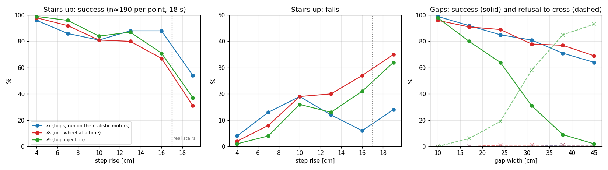

# Diagnosis of the skill teachers (v7, v8, v9) and the way forward

*Written 2026-11-16. Independent review of the code, the logs, the videos and the conversations of 2026-11-07 to
2026-11-11, plus new measurements on the saved checkpoints. Nothing was trained and no code was changed for this
review. It corrects parts of [experiments.md](experiments.md) §3–4 and of [status_and_plan.md](status_and_plan.md).*



## 1. Verdict

1. **v9 did not learn to hop.** Its policy never fires the jump primitive (0.0–0.2 jumps per robot on stairs). The
   hop injection drove the trigger output to −16 … −54, far below anything the exploration noise can reach.
2. **v9 is not better than v8 on the high stairs.** The reported gain at 19 cm (22% → 56%) came from about 20
   robots per cell. With about 190 robots per cell it is 31% → 37%, inside the noise.
3. **v9 lost the gaps because it refuses to cross them**, not because it falls: at 45 cm, 93% of the robots stop
   about 1 m before the trench. The most likely cause is the injection itself (§4.3).
4. **The hop works with the realistic motors.** v7, which hops, was re-evaluated on today's environment (hip
   limits, torque–speed droop, lag, power limit, action delay, none of which it trained with). It beats v8 and v9
   on the high stairs and falls much less: at 16 cm, 88% success and 6% falls, against 67% and 27% for v8.
5. **The owner's intuition was right:** hopping with both wheels is the better and more stable strategy for this
   robot. v8 did not reject it; v8 never got to try it (§4.1).
6. **Recommendation:** discard v9 and the injection mechanism. Fix the evaluation first. Then train v10 by
   continuing **v7** on the realistic environment (§6).

## 2. What was measured

One probe script ran the three final checkpoints on the current code, deterministic policy, 18 s per robot, the
same spawn rules as `skill_eval.py`:

- all 11 terrain types, 100 robots per type and level (about 45 per cell where stairs split into up and down);
- stairs only, every robot climbing, about 190 robots per cell;
- stairs with the weakest and the strongest motor draw of the randomisation range, about 143 robots per cell.

Besides success and falls it records: robots that neither fall nor advance ("refusal"), jump-primitive starts,
steps climbed measured under the **wheels**, roll, heading error, leg extension speed, peak mechanical power,
trench crossings, and how far from a trench a stopped robot stands.

Script and raw outputs: `experiments/analysis_2026-11-16/` (`probe.py`, `full_v7|v8|v9.json`,
`stairs_up_n190.txt`, `stairs_weak_strong_motors.txt`). Videos: `videos/analysis_2026-11-16/`.

Caveat on v7: its actions are interpreted here with the v8 scales (push 130–250 N instead of 150–300 N, leg angle
±0.35 rad instead of ±0.5 rad). It still works, so the result is conservative for v7.

## 3. Findings

### 3.1 Stairs up, same environment for all three (about 190 robots per cell, 18 s)

Success % / falls %; the rest neither fell nor covered 2.5 m.

| rise | 4 cm | 7 cm | 10 cm | 13 cm | 16 cm | 19 cm |
|---|---|---|---|---|---|---|
| v7 (hops) | 96 / 4 | 86 / 13 | 81 / 19 | 88 / 12 | **88 / 6** | **54 / 14** |
| v8 | 98 / 2 | 92 / 8 | 81 / 19 | 80 / 20 | 67 / 27 | 31 / 35 |
| v9 | 99 / 1 | 96 / 4 | 84 / 16 | 87 / 13 | 71 / 21 | 37 / 32 |

Long flight (8 steps), success % / falls %:

| rise | 4 cm | 7 cm | 10 cm | 13 cm | 16 cm | 19 cm |
|---|---|---|---|---|---|---|
| v7 | 96 / 4 | 80 / 20 | 76 / 24 | 77 / 22 | 63 / 26 | 30 / 16 |
| v8 | 94 / 6 | 79 / 21 | 68 / 32 | 60 / 38 | 48 / 39 | 20 / 38 |
| v9 | 98 / 2 | 90 / 10 | 78 / 22 | 84 / 16 | 52 / 35 | 22 / 44 |

v9 is modestly better than v8 at the middle levels and on hurdles (it trained 7000 more iterations, with long
flights and hurdles in the mix). That gain does not come from hops.

### 3.2 How each policy climbs

Stairs up, 13–19 cm:

| | v7 | v8 | v9 |
|---|---|---|---|
| jump-primitive starts per robot | 7–8 | 0.00–0.01 | 0.03–0.13 |
| trigger action, mean | −0.6 | −0.2 | **−31 … −50** |
| largest roll (median) | 9–10° | 19–22° | 18–20° |
| heading error against the command | 9–12° | 13–20° | 14–20° |
| leg extension speed (median of the peak) | 4.0–4.3 m/s | 2.7–3.2 m/s | 3.0–3.2 m/s |
| peak positive mechanical power, six motors | 650–760 W | 520–570 W | 530–560 W |

- **v8 and v9 use the same gait:** the body yaws, one wheel goes up at a time, the body rolls about 20°. The
  videos confirm it. It is a real gait, not a glitch, but it is asymmetric: in v8 the force residual of one leg
  sits at its limit 47–55% of the time.
- **v7 hops square to the stairs** with both wheels: extend, tuck, land crouched, extend again
  (`v7_realistic_motors_stairs_L4.mp4`, CPU simulator, 20 N·m, droop, 2 ms lag, 700 W, hip limits: it reaches the
  top of the 16 cm flight). It uses 1.6–2.5 primitive jumps per step gained, so some hops are wasted.
- v7's extension speed is above the 2.5 m/s that `extension_speed` punishes, yet inside the motor model
  (the droop is what limits it). The 2.5 m/s threshold is a taste choice, not a physical limit.

### 3.3 Motor strength decides the high stairs

Stairs up, success % / falls % at the two ends of the randomisation range (weak: 18 N·m, no-load speed ×0.8,
500 W, 4 ms lag, 10 ms delay; strong: 25 N·m, ×1.05, 900 W, 1 ms, no delay):

| | 16 cm weak | 16 cm strong | 19 cm weak | 19 cm strong |
|---|---|---|---|---|
| v7 | 54 / 13 | **95 / 1** | 14 / 21 | 56 / 8 |
| v8 | 43 / 26 | 77 / 21 | 6 / 31 | 34 / 33 |

With the weak draw nobody climbs 19 cm (about one step). The real actuator's torque–speed curve is therefore the
most valuable missing number in the project: it moves the 16 cm result from 54% to 95%.

### 3.4 Gaps

Success % / falls % / refusal %, 100 robots per cell:

| width | 10 cm | 17 cm | 24 cm | 31 cm | 38 cm | 45 cm |
|---|---|---|---|---|---|---|
| v7 | 99 / 1 / 0 | 92 / 8 / 0 | 85 / 15 / 0 | 81 / 19 / 0 | 71 / 28 / 1 | 64 / 35 / 1 |
| v8 | 96 / 4 / 0 | 91 / 9 / 0 | 89 / 10 / 1 | 78 / 21 / 1 | 77 / 22 / 1 | 69 / 30 / 1 |
| v9 | 98 / 2 / 0 | 80 / 14 / 6 | 64 / 17 / 19 | 31 / 11 / 58 | 9 / 6 / 85 | **2 / 5 / 93** |

- **v8 does not roll across the gaps** (a 21.5 cm wheel cannot roll over a 45 cm trench). It jumps them with the
  continuous residuals (leg length and leg force), never with the primitive: 3.5 crossings per robot at 45 cm,
  0.0 with the primitive, 0.6–1.0 s airborne per episode. The policy can already build a jump of its own.
- v9's stopped robots stand with the trench 0.95–1.1 m ahead. On `gaps_wide` 64–94% refuse at every level.

## 4. Root causes

### 4.1 Why v8 never hopped

v7 and v8 used the same training recipe and seed; only the environment changed. In v7 the trigger stayed alive from the start: at iteration 1000
every robot on the stairs already jumps (3–7 times), although it climbs almost nothing above 10 cm. The hops only
became good at 13–16 cm after iteration 5000. Mastering the hop took most of the run.

In v8 the early hops did not pay: weaker push (130–250 N instead of 150–300 N), weaker motors, and new costs on
exactly what a hop does (extension speed, power, hip-limit proximity). The trigger was pushed down while the
robots were still on easy levels. The exploration noise fell to its floor (0.10) by iteration 2000 with no
entropy bonus, which left the 0.5 threshold about 7 σ away. Later, the one-wheel gait filled the gap.

So v8's gait is the result of an exploration failure in the first thousand iterations, not a comparison of the
two strategies.

### 4.2 Why the injection in v9 could not work

The injection overwrites the trigger with 0.65 near edges and stores that as the action taken. Three things break:

1. **PPO only moves the mean away, never back.** A hop that goes badly pushes the trigger mean down each
   iteration. A hop that goes well can pull it up only by a tiny amount, because a sample that is many σ from the
   mean hits the clipping after a minuscule change. The mean drifts one way.
2. **Nothing stops the drift.** The environment clamps actions to ±1 and the `action` cost uses the clamped
   value, so −50 costs the same as −1. That is how the trigger reached −16 … −54. From there it is unrecoverable.
3. **The crashes were this same problem.** The two NaN crashes were importance ratios of ~1e5 from these samples.
   Capping the log-ratio (the `torch.exp` patch in `train.py`) removed the symptom and hid the cause.

The policy never controlled the hops it was credited with. `hop_climb` and the penalty mask paid for forced
hops only.

### 4.3 Why v9 refuses gaps (most likely, not proven)

In training, a robot within 0.2–0.6 m of a trench edge gets a forced hop with 0.5–1.5% probability per step,
about 12–31% per approach, at a random distance. On a wide trench that is a fall. The policy cannot veto the hop,
so the only defence is not to approach. The curriculum then moves a robot that does not advance to an easier
level, which hides the problem during training. The evidence fits (refusals grow with width, robots stop 1 m out,
falls stay low), but no run isolates it.

## 5. What is wrong, and the fix

### 5.1 Evaluation and record

| # | Problem | Fix |
|---|---|---|
| E1 | `skill_eval.py` gives about 19–26 robots per cell (2520 robots over 66 tiles, half of the stairs robots climbing). A cell's standard error is about ±10 points. v9 was accepted on that. | At least 150 robots per cell; climbing and descending in separate runs; print the count and a confidence interval. |
| E2 | "Success" hides refusals. v9's gap result reads as failure by falling; it is 93% refusal. | Report success / falls / refusal. |
| E3 | Hop usage was never measured before v9 was judged ("not measured yet"). | Report primitive starts per robot per terrain in every evaluation. |
| E4 | Steps climbed are sampled under the **base**, not the wheels (`skill_env.py`, `g = self._sample_ground(self.qpos[:, 0:2])`). Leaning over the next step counts as climbing it. It over-reports by 0.3–0.8 step, and the same number feeds the `climb` reward and the level-up rule. | Use the lower of the two wheels' ground heights. |
| E5 | One evaluation mixes motor draws. The result depends strongly on them (§3.3). | Also report fixed weak / nominal / strong sets. |
| E6 | The analysis scripts of experiments.md §3 were not kept. | Ship the probe in `sim/warp_rl/` (start from `experiments/analysis_2026-11-16/probe.py`). |

Statements to correct in the docs:

| Where | Statement | What the data says |
|---|---|---|
| experiments.md §4, status_and_plan.md | v9 met the 19 cm criterion (22% → 56%) | 31% → 37% with 190 robots per cell; not met |
| experiments.md §4 | v8 crossed gaps by rolling | it jumps them with the continuous residuals |
| experiments.md §4 | gaps regression: the policy hops with a stair-tuned shape and does not land | it does not hop at all; it refuses to approach |
| experiments.md §2, status_and_plan.md | one-leg climbing is not possible without hip abduction | v8 and v9 do exactly that, by yawing and rolling |
| experiments.md §6 item 2 | targeted exploration (injection) listed among "fixes that worked" | it did not work |
| experiments.md §2 (v8) | the realistic model cost 50 points at 19 cm (v7 71% → 22%) | v7 itself scores 54% on the realistic model; most of the loss was the lost hop |
| status_and_plan.md | next decision: keep injecting only at step edges, continue from v9 | discard v9 |

### 5.2 Training code

| # | Problem | Fix |
|---|---|---|
| T1 | Hop injection (`skill_model._inject_hops`, `train.hop_assist`, `--assist-*`) | Remove. |
| T2 | `torch.exp` replaced inside `rsl_rl.algorithms.ppo` (`train.py`) | Remove with T1; it only existed to survive the injection. |
| T3 | Hard-coded std floor 0.3 on actions 8–11 (`train.py`) | Remove with T1. With a trigger mean near −0.2 it would fire random hops everywhere. |
| T4 | Action means are unbounded while the environment clamps to ±1; the `action` cost uses the clamped value | Penalise the unclamped action beyond ±1 (or squash the mean), so no output can run away again. |
| T5 | `hop_climb` reward | Remove, or keep only once the policy fires hops itself. Keep the 0.3 s penalty mask after a hop. |
| T6 | `extension_speed` threshold of 2.5 m/s is below what a working hop needs (4 m/s) and is not a motor limit | Raise to about 4.5 m/s, or drop it and rely on the motor model. |
| T7 | No left–right symmetry: the policy learns one-sided habits (v8's saturated leg force) | Mirror augmentation in PPO (`symmetry_cfg`, already supported by RSL-RL). |
| T8 | Entropy bonus 0, exploration noise at its floor by iteration 2000 | Small entropy bonus or a higher floor in the first third of a from-scratch run. Not needed for a fine-tune. |

### 5.3 Environment realism (matters for the real stairs)

| # | Problem | Fix |
|---|---|---|
| R1 | The stairs are a 5.8 m wide pyramid, and the heading command is up to ±17° off the stairs. A yawed gait drifts sideways for free; in a 1 m stairwell it would hit the wall. | Add straight flights 0.9–1.2 m wide with side walls; command the heading along the flight. |
| R2 | 5 or 8 steps only, level-up after 3. The owner's requirement is "does not die half way" on 10–50 steps. | Flights of 12–16 steps; measure flights completed, not distance. |
| R3 | Steps have no nosing; tread fixed at 0.30 m | Randomise tread 0.26–0.32 m and a 0–3 cm nosing. |
| R4 | Motor parameters are estimates drawn over a wide range | Measure the real actuator (torque–speed, peak current, lag) and narrow the range. |

## 6. The way forward

Every training step needs the owner's go-ahead.

**Step 0. Repair the instruments (no training, about half a day).**
E1–E6, T1–T6, and the doc corrections of §5.1. Re-run the three checkpoints once with the fixed `skill_eval.py`
so that v7, v8 and v9 have comparable reference numbers.

**Step 1. v10: continue v7 on the realistic environment (about 3 h, 3000–4000 iterations).**
- Start from `2026-11-07_15-29-25-skill-teacher-v7/logs/model_9999.pt` with `--resume`; current environment and
  terrain set (hurdles, wide gaps, long flights included); no injection; penalty mask after a hop kept.
- Why continue instead of starting over: the hop needs to survive the first thousand iterations and then takes
  5000+ iterations to mature (§4.1). v7 already has both. The earlier lesson "continuing does not repair habits"
  applies in reverse here: the habit is the one we want to keep.
- Stop rule: evaluate every 500 iterations. If primitive starts per robot on 13–16 cm stairs fall below 2, stop:
  the costs are extinguishing the hop again.
- Acceptance, 150+ robots per cell, 18 s:
  - 16 cm stairs: success ≥ 90% and falls ≤ 8% with the nominal draw; no worse than v7 with the weak draw;
  - 19 cm stairs: success ≥ 54% (v7 today);
  - gaps: no worse than v8 at every level (69% at 45 cm), refusal below 5%;
  - roll on stairs ≤ 12° (median of the peak), no hip at its limit.
- If it fails: train from scratch with T7 and T8 and without the hop costs for the first 2000 iterations.

**Step 2. v11: real stairs, long flights, symmetry.**
R1–R3 and T7, continuing v10. Metric: share of 12- and 16-step flights completed at 16–17 cm. Target ≥ 90% with
the nominal draw. This is the step that answers "it must not die half way".

**Step 3. Make the hop "flush" and efficient.**
v7 spends about two primitive jumps per step and the primitive forces a 0.5 s pause between hops. First shorten
the cooldown and lower the minimum push, then the roadmap's option 3 (the policy modulates leg length during push
and tuck) or drop the primitive entirely: v8's gap jumps show the continuous residuals can already produce a jump.

**Step 4. Camera gap, before any distillation.**
Run the winning teacher through the CPU stack with `--scan map` on stairs, gaps and bars, 20+ runs each. Hop
timing is decided 0.2–0.5 m from the edge, inside the camera's blind near field, so the student will depend on
map memory. Two single runs on 16 cm stairs with the map (`videos/analysis_2026-11-16/*camera_map*`): v7 reached
the top, v8 did not. Two runs prove nothing; they only show the test is cheap.

**Step 5. Students**, as already planned: short history vs about 1 s vs GRU, from the same teacher.

**In parallel, on the bench:** measure the actuator (R4). It decides whether 19 cm is a training problem or a
hardware limit.

## 7. Open points for the owner

1. **The 19 cm level.** The real stairs are about 17 cm. With the weak motor draw nobody climbs 19 cm. Is 19 cm a
   requirement, or a margin level? It should not be an acceptance criterion until the actuator is measured.
2. **Extension speed.** v7's hops extend the legs at about 4 m/s. The motor model allows it. If the mechanism
   should not see that, say so and it becomes a hard limit in the plant instead of a reward cost.
3. **Descent with one wheel ahead.** v7, v8 and v9 all descend with about 20° of yaw and 65–100% success. It is
   not addressed here; R1 (narrow flights) will force the question.

## 8. Reproducing

```bash
# full suite, 100 robots per type and level
~/test/isaac-rl/bin/python experiments/analysis_2026-11-16/probe.py --checkpoint <run>/logs/model_N.pt \
    --per 100 --seconds 18 --out out.json
# stairs only, all climbing, ~190 per cell; add --weak or --strong for the motor extremes
~/test/isaac-rl/bin/python experiments/analysis_2026-11-16/probe.py --checkpoint <run>/logs/model_N.pt \
    --types stairs,stairs_wide,stairs_long --p-climb 1 --per 200 --seconds 18
```

Run from `sim/warp_rl/`. Output columns: count, top reached, success, falls, refusal, distance, primitive jumps
per robot, share of robots that jumped, steps under the wheels / steps as the environment reports them, airborne
time, one-wheel time, leg split, heading error, roll, extension speed, trench crossings, trigger mean, heading
against the stair axis, lateral drift, progress, peak power, trench distance of stopped robots.
