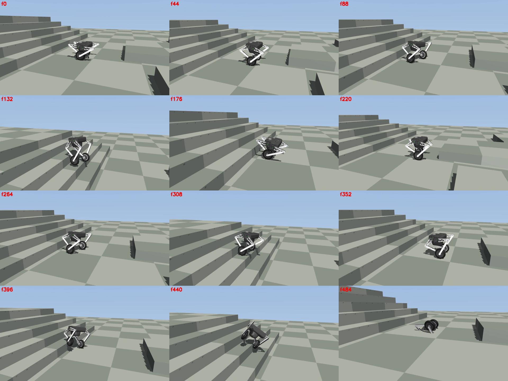
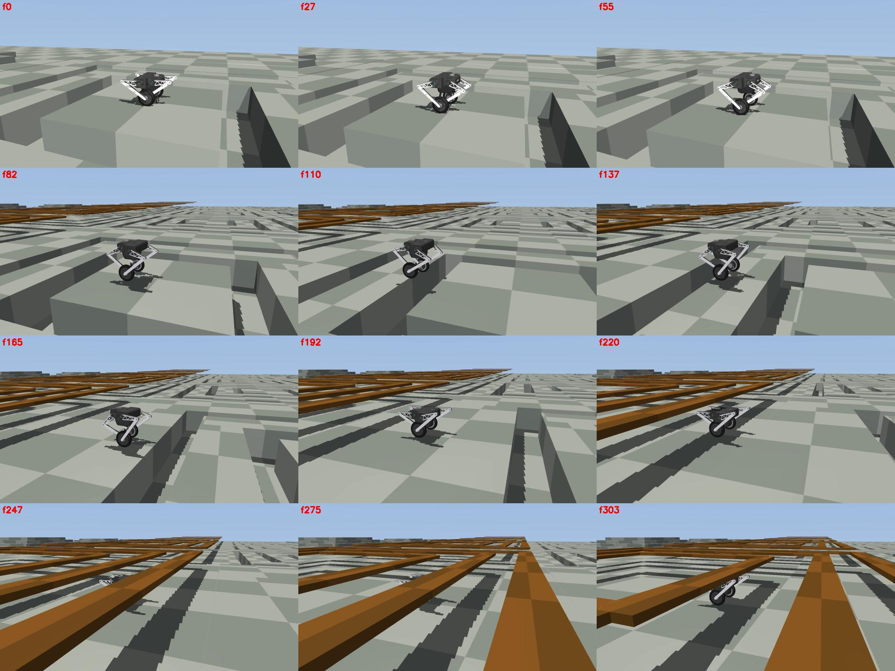

# Experiment log: how the autonomous-skills policy was built

*Written 2026-11-11, updated 2026-11-17 (v9 corrected, v10, v11, v12 plan). This is the scientific record of the reinforcement-learning work: what was tried, what
happened, why, how it was fixed, and which decisions followed. Numbers come from `skill_eval.json` of each run
(`experiments/<run>/`); "success" = no fall and at least 2.5 m covered in 12 s. For the current state and the
plan, see [status_and_plan.md](status_and_plan.md). For the controller itself, see
[model_and_control.md](model_and_control.md).*


## 0. Context and method

PRIMUS balances on two wheels with a model-based controller (LQR scheduled on leg length + VMC through the
closed 5-bar Jacobian). The learned policy is a **residual** on top of it: it never outputs motor torques, it adds
small corrections (leg length, leg angle, wheel torque, leg force) and, for the skills, one extra action that
**triggers a jump primitive** (push both legs out, then tuck them). Training: PPO (RSL-RL 5.4) on 4096 robots in
MuJoCo Warp, ~45k policy steps/s on one GPU. The teacher sees privileged information (a perfect height scan of the
ground ahead, true velocity, motor limits); a student is meant to be distilled from it using only the simulated
camera map.

Rule used throughout: every policy is evaluated per terrain type and per curriculum level against the controller
alone, on identical scenarios (`skill_eval.py`).

## 1. Lessons before the skills (Oct 2026)

| Date | Experiment | Outcome | Lesson / decision |
|---|---|---|---|
| 2026-10-31 | Isaac Sim, PPO on raw motor torques | the robot lowered the landing gear and sat on it | reward paid ~full for a tilted robot, lenient termination, gear target never set. Do not learn balance from scratch next to a working LQR. Details: [terrain-run-2026-10-31.md](terrain-run-2026-10-31.md) |
| 2026-10-31 | **Residual** PPO on the LQR, MuJoCo Warp (warp-residual-v2) | falls/min 0.265 → 0.069, speed error 0.207 → 0.094 m/s | residual keeps the safe base and trains in 50 min. Exploration noise must be bounded: when std grew to 0.66 falls went from 2% to 75% |

## 2. Skill teacher, v1 to v8

Terrain: tiles of 8 m, 6 curriculum levels per type (flat, rough, slope, stairs, curbs, gaps, overhang, later
wide-tread stairs). Stairs rise 4/7/10/13/16/19 cm; the real stairs are ~17 cm, the wheel radius is 10.75 cm, so
from ~10 cm a step cannot be rolled over, it needs a two-wheel jump (the robot has no hip abduction, so it cannot
climb one leg at a time).

### v1: no jump primitive (stopped at 1500 iterations)
- **Result:** stairs down 80% → 87–100%, gaps up to 31 cm and curbs clearly better than the controller alone.
  Stairs **up** only at 4 cm (100%) and 7 cm (26%); from 10 cm the robot stays at the foot.
- **Why:** exploration noise collapsed to its floor (std 0.07). A two-wheel jump is a coordinated pulse of
  extension and tuck; random noise never produces it.
- **Decision:** give the controller a jump primitive and let the policy only decide *when* (trigger), keep std ≥ 0.1.

### v2: jump primitive
- Primitive in `control/repo_control_policy.py`, mirrored in the Warp kernel (parity test). Measured alone: the
  wheels clear 23–29 cm at 18–20 N·m, ~35 cm at 25 N·m.
- **Result:** gaps 31–45 cm 69–73% (v1: 31–62%), bars to 52 cm free height 83%, stairs up 7 cm 58%, **0% from 10 cm**.
- **Why:** climbing one or two steps earned nothing unless the robot covered 2.5 m. Sparse reward, no gradient.
- **Decision (v3):** dense `climb` reward (every new ground height under the wheels, only while grounded) and
  level-up after 3 steps climbed.

### v3 (4000 iterations)
Stairs up 7 cm 71%, 10 cm+ still ~0–8%. Stairs down 89–97%, gaps to 45 cm 73–100%, bars 79–100%, curbs 25–96%.
First camera **student** (distilled from v3): near the teacher on stairs down, curbs, bars, but gaps from 24 cm
collapse (0–17% vs 73–88%): with a level camera the inside of a gap and the treads past an edge are never seen
and the near field is blind (~0.85 m), so jump timing depends on memory and drift.

### v4 to v6: policy-shaped jump, then wide treads
- **v4:** 12 actions, the policy also chooses extension, push force and tuck length (latched at the trigger),
  climbing focus (70% of stairs robots climb), 20 s episodes, climb reward ×2. Initialised from v3 with remapped
  weights (exact to 4e-7). Stairs up still ≤ 12% from 10 cm.
- **v5:** 3000 more iterations of v4. No improvement on stairs up (0–5% from 13 cm). Continuing a policy that
  has already settled into "do not jump" does not recover the behaviour.
- **v6:** added wide-tread stairs (0.50 m): room to land and chain jumps. Stairs up 10 cm 33% (v5: 5%), wide
  stairs 13 cm 45%, 19 cm only 13%.
- **GRU student** from v5 (recurrent, camera map): trained for the perception route (not evaluated against v7/v8); its quality is bounded by the
  teacher it copies, so student work waits for a better teacher.
- **Diagnosis after v6:** the continued runs carry habits. Decision: retrain **from scratch** with a new
  architecture and the final action space.

### v7: from scratch, `encoders` architecture (10 000 iterations, 6.7 h)
- Separate encoders for the scan (155→128→32), ceiling (45→32→8) and privileged vector (8→32→8), then an MLP
  512-256-128. Stairs up on real 30 cm treads: 4.1 / 4.6 / 3.7 / 2.6 of 5 steps at 10/13/16/19 cm
  (v6: 2.3 / 1.0 / 1.1 / 0.7). Best numbers so far.
- **But the videos showed behaviour the real robot cannot do:**
  1. an upper-arm link turning a full circle (hips had no limits, the 5-bar folded through itself);
  2. legs split ~60° on the way down (the leg-angle residual allowed it at no cost);
  3. jumps always at full push with an ideal motor (peak power ~675 W, leg speed ~4.5 m/s, far above the battery
     and the actuators).
- **Decision:** results from v7 are not trustworthy for sim-to-real. Keep the architecture, fix the physics.

### v8: realistic hips and motors (10 000 iterations, 7 h)
Changes, all aimed at removing "free" physics:
- hip joint limits from the CAD (`model.HIP_RANGE_DEG`: hip_Yp −49..118°, hip_Ym −124..47°);
- motor model in the kernel: torque limit drawn per robot (18–25 N·m) with speed droop W0 ×0.8–1.05, torque lag
  1–4 ms, action delay 0–10 ms, battery power limit 500–900 W, gearbox friction. Electrical estimates:
  `hardware/actuators.json` (`estimates_2026_11_10`);
- push force 130–250 N, leg-angle residual ±0.35 rad;
- new costs: hip-limit proximity (−20), leg split above ~0.2 rad (−3), positive power (−0.002), leg extension
  speed above 2.5 m/s (−0.5), climb reward 40.

**Result.** Movement became plausible: peak power 340–380 W (v7 ~675), extension 2.5–3.1 m/s (v7 ~4.5), median
leg split 15°, no spinning links. Success by level (0→5):

| terrain | v8 success (%) |
|---|---|
| stairs up | 96 / 67 / 59 / 60 / 75 / **22** |
| stairs down | 100 / 88 / 90 / 86 / 93 / 80 |
| curbs | 94 / 88 / 69 / 79 / 54 / 60 |
| gaps | 98 / 96 / 83 / 77 / 77 / 69 |
| stairs, wide treads, up | 100 / 88 / 86 / 88 / 91 / 47 |

Steps climbed (of 5) at 4–19 cm: 4.7 / 4.3 / 3.1 / 4.3 / 4.1 / 2.5. Cost of realism: the 19 cm stairs (the real
17 cm stairs are between level 4 and 5) dropped from 71% (v7, ideal motors) to 22%.

| 19 cm stairs: v8 fails | 45 cm gap: v8 crosses |
|---|---|
|  |  |

## 3. Diagnosis: why v8 never uses the jump, and what the jump can do

User observation (v7 vs v8): the robot rolled and shuffled up the stairs, never jumping, even on gaps. Three tests
on the final v8 checkpoint answered it.

1. **Trigger usage by terrain** (`probe.py`): the jump trigger fired essentially never on stairs or gaps.
   Reason: the trigger action's mean sat near −0.22 and the global std floor was 0.1, so the 0.5 threshold was
   **~7σ away**. Exploration of the jump had died, the same failure as v1 at a smaller scale. With a realistic
   motor the jump is also a risky, low-reward-difference option compared with creeping over a step.
2. **Maximum jump with the realistic motor model** (`maxjump.py`; flat ground, standing, extension 0.52 m, tuck
   0.18 m, start leg 0.25 m): wheel clearance **24 cm** (18 N·m, W0×0.8, 500 W) to **33 cm** (25 N·m, W0×1.05,
   900 W); airtime 0.16–0.20 s. Most of the clearance comes from the tuck, the CoM itself rises little.
   So a 17 cm step is jumpable even with the weakest motor draw, but with little margin and no room for error in
   timing.
3. **Scripted hop** (open-loop push-tuck at a fixed distance before the step, LQR only; `scripted.py`,
   `search.py`, `trace.py`): at best ~2 of 5 steps, many configurations did not jump at all (the primitive only
   starts if `avg_len < ext − 0.05`, so a 0.40 m extension from a 0.35 m leg never fires; this also produced
   misleading "no-fall" scores in the first random search). Conclusion: a blind scripted hop is not viable; the
   policy must learn timing and recovery.

**Target behaviour (user decision):** a hop that lands *flush* on the next step with both wheels together, judged
more stable than one wheel at a time. Gaps, and later larger gaps and equestrian-style hurdles, must keep working
or be trained.

## 4. v9: teaching the hop (failed; see the correction at the end of this section)

Hypothesis: the jump is never discovered because exploration cannot reach the trigger; if the rollout shows PPO the
outcome of hops near step edges, the policy will learn to use them. Changes:

**Terrain** (`skill_terrain.py`, new types appended so old indices are unchanged): `hurdles` (thin walls 6–24 cm
in three square rings), `gaps_wide` (30–80 cm), `stairs_long` (8 steps). Spawn weights rebalanced
(`type_weights`), fast commands (0.8–1.6 m/s) on hurdles and wide gaps, long flights need 6 steps to level up.

**Reward** (`skill_env.py`): `hop_climb` = 15 × height gained while a hop is in flight or within 1 s of it. The
hop is exempt from the penalties that would otherwise forbid it: vertical speed, positive power and extension
speed are masked for 0.3 s after a jump (`since_jump`).

**Exploration by injection** (`skill_model.py`, `SkillTeacherModel._inject_hops`): in rollouts only, where the
centre column of the scan shows a step edge (rise 5–30 cm, 0.15–0.45 m ahead) or a trench edge, and the robot stands
on level ground, a few percent of steps (3% decaying to 1% over the first 60% of training; trenches half as
often) replace the trigger action with 0.65. The stored action is the injected one, so PPO credits the outcome to
the trigger. Frequency per terrain was measured first (`inj.py`): 0% on flat and rough ground, ~1–5% of the time
on terrains with edges. The first version also fired on gaps, rough ground, slopes and overhangs; edge
detection by differences between neighbouring scan cells fixed that.

**Initialisation:** from v8 (`--init-from`, 7000 iterations planned), acceptance criteria agreed with the user:
stairs up at 19 cm clearly above 22%, and gaps no worse than v8. v8 baseline on the new terrains (level 0 → 5):
hurdles 63→3%, gaps_wide 68→0%, stairs_long up 100→19%.

### Failures during v9, and fixes

| # | Symptom | Cause | Fix |
|---|---|---|---|
| 1 | Run 1 crashed at iteration 419: `RuntimeError: normal expects all elements of std >= 0.0` (NaN policy). Noticed because the GPU was idle | the injection also replaced the jump *shape* actions (extension, push, tuck) with random values up to **12σ** from the policy distribution; the log-probability gradient of such samples blew the weights up | inject only the trigger (0.65), keep the policy's own shape samples; std floor 0.25 on actions 8–11 (the injected trigger sits ~2σ from the mean) |
| 2 | Run 2 crashed at iteration ~660, same error. One batch had `surrogate loss` 20151 (importance ratio ~1e5), two steps later NaN | even a trigger at 3–4σ gives a huge ratio exp(Δlogp) for negative-advantage samples after a small policy shift; PPO clips the ratio only on one side | cap the log-ratio at 1.5 inside PPO's loss (`train.py`: replaces `torch.exp` in `rsl_rl.algorithms.ppo` for the skills task, so one outlier cannot dominate), std floor 0.3, resumed from checkpoint 500 |

Run 3 passed the previous crash point (iteration 660) cleanly. It is expected to finish in about 4.5 h.
Early training signals (iteration 90): `Metrics/fell` ≈ 0.55 (high on purpose: new hard terrains and hops),
`hop_climb` ≈ 0.011 and growing; surrogate loss normal.

### v9 result (final checkpoint, 6500 + 500 iterations, evaluated 2026-11-11)

Success by level (0 → 5), v8 → v9:

| terrain | v8 | v9 |
|---|---|---|
| stairs up | 96 / 67 / 59 / 60 / 75 / 22 | 100 / 100 / 69 / 76 / 57 / **56** |
| stairs down | 100 / 88 / 90 / 86 / 93 / 80 | 100 / 96 / 100 / 86 / 88 / 82 |
| curbs | 94 / 88 / 69 / 79 / 54 / 60 | 97 / 97 / 95 / 87 / 76 / 76 |
| overhang | 100 / 90 / 88 / 71 / 81 / 73 | 97 / 97 / 100 / 92 / 87 / 82 |
| stairs, wide treads, up | 100 / 88 / 86 / 88 / 91 / 47 | 100 / 94 / 94 / 87 / 100 / 56 |
| **gaps** | 98 / 96 / 83 / 77 / 77 / 69 | 100 / 92 / 69 / 36 / **10 / 5** |
| hurdles (new) | 63 → 3 | 74 / 66 / 55 / 50 / 29 / 16 |
| gaps_wide (new) | 68 → 0 | 34 / 21 / 3 / 0 / 0 / 0 |
| stairs_long up (new) | 100 → 19 | 100 / 100 / 84 / 65 / 50 / 25 |

Verdict against the agreed criteria: **stairs up at 19 cm met** (22% → 56%) and curbs, overhangs, wide stairs and
hurdles improved; **gaps failed** (69% → 5% at the widest level, collapsing from level 3) and `gaps_wide` got worse
at level 0 (68% → 34%). Hypothesis for the gap regression, not yet tested: the injection fires at trench edges
too (half rate), so the policy learned to hop at gaps with the stair-tuned shape and does not clear or land them;
v8 crossed gaps by rolling. Not measured yet: how often the trigger fires per terrain in v9 (`probe.py` on the new
checkpoint) and the airtime of those hops.

> **Correction (2026-11-16, [diagnosis_2026-11-16.md](diagnosis_2026-11-16.md)).** The table above was measured
> with about 20 robots per cell and is wrong in its main claims. With about 190 robots per cell: **v9 never fires
> the jump primitive** (0.0–0.2 starts per robot on stairs; the injection drove the trigger output to −16 … −54);
> stairs up at 19 cm is 31% (v8) → 37% (v9), inside the noise; the gap loss is **refusal**, not falls (93% of the
> robots stop about 1 m before a 45 cm trench). v7, which hops, re-evaluated on the realistic environment beats
> v8 and v9 on the high stairs (16 cm: 88% success / 6% falls against 67% / 27% for v8). Decisions: discard v9 and
> the injection (code removed), fix `skill_eval.py` (150+ robots per cell, success / falls / refusal, primitive
> starts, steps under the wheels), continue v7 on the realistic environment (v10).

**Open risks:** the injection may hurt gaps that v8 solves by rolling through (watch gaps/stairs falls around
iteration ~1500); whether the policy keeps hopping after the injection probability anneals to 1% is unknown; hop
timing may not transfer to the student's camera map (blind near field).

## 5. v10: v7 continued on the realistic environment (4000 iterations, 2026-11-16)

Run `2026-11-16_14-38-53-skill-teacher-v10`, `--resume` from v7 `model_9999.pt`, final `model_13998.pt`. Code
changes since v9 (all in this commit): injection and the `torch.exp` patch removed, `hop_climb` removed,
`climb` measured under the lower wheel (not under the base), extension speed free up to 4.5 m/s (the motor model
limits the rest), `action_excess` cost on raw actions beyond ±1 (v9's trigger drifted to −50 because the clamp
hid it), new `skill_eval.py`.

Result (about 190 robots per cell for stairs up, 150 otherwise; done / fell %, levels 4 → 19 cm):

| terrain | v10 |
|---|---|
| stairs up | 98/2, 96/4, 92/8, 91/9, 98/2, 91/5 |
| stairs up, weak motors, 16 / 19 cm | 93 / 85 done |
| gaps (10 → 45 cm) | 98 → 85 done |
| stairs_long up (8 steps) | 54–76 done |
| stairs_long down | ~50 done |
| hurdles | 82 → 50 done |
| gaps_wide (30 → 80 cm) | 81 → 15 done |

All acceptance criteria of the diagnosis met (16 cm ≥ 90% / ≤ 8% falls, 19 cm ≥ 54%, gaps no worse than v8, no
refusals). The hop survived the realistic plant: 5–8 primitive starts per robot on stairs. Weak points: long
flights and walled flights (below).

## 6. v11: walled 12-step stairwells (4000 iterations, 2026-11-16)

Run `2026-11-16_17-42-01-skill-teacher-v11`, `--resume` from v10, final `model_17997.pt`. New terrain type
`stairs_narrow`: three straight flights of 12 steps between side walls (0.95–1.30 m wide, treads 0.28–0.32 m),
spawn in a flight at the foot (facing up) or on the top platform (facing down), episode ends when the flight is
done; a level-up there needs the whole flight. Walls are boxes in the physics and in the camera's `ground` grid,
not in the walkable `floor` grid used for falls and climbing.

Result (`eval_all.txt`, `eval_stairs.txt`, `eval_weak|nominal|strong.txt` in the run directory):

| terrain (levels 4 → 19 cm) | v10 | v11 |
|---|---|---|
| stairs_narrow up, done / fell | 31–44 / 55–68 | 98/2, 69/30, 81/19, 96/4, 95/5, 92/5 |
| stairs_narrow down, done | 83–98 | 94–100 |
| stairs up, done / fell | see §5 | 100/0, 93/7, 90/10, 93/7, 95/5, 91/2 |
| stairs_long up, done | 54–76 | 97, 90, 86, 88, 82, 78 |
| stairs_long down, done | ~50 | 81–88 |
| gaps (10 → 45 cm), done | 98 → 85 | 87–98 (45 cm: 91) |
| gaps_wide, done | 81 → 15 | 92 → 36 |
| hurdles, done | 82 → 50 | 87 → 53 |
| stairs up, weak motors, 16 / 19 cm | 93 / 85 | 77/23, 75/8 |

v11 is the best teacher so far: about 12 hops per robot for 11–12 steps on the walled flights.

### What the v11 analysis found (2026-11-16, `experiments/analysis_2026-11-16/asym_probe.py`, `drive_probe.py`)

- **Falls per step.** A walled flight at 16 cm loses about 0.44% of the robots per step: about 20% falls over 50
  steps, far from "it must not die half way".
- **Walled flights at 7 and 10 cm** (n ≈ 280): 36% and 22% falls; 96% / 60% of them the chassis hitting a step.
  The policy hops only about half of the steps there and the robots that fell hopped less.
- **Left–right asymmetry, in every teacher.** The controller alone is symmetric (leg split 0.06°), but every policy
  holds a fixed staggered stance on flat ground: leg split v7 +19°, v8 −17°, v10 +16°, v11 +15° (about 8 cm of
  wheel offset), with a 12 cm leg-length difference (≈ 40° roll reference, saturating the roll loop) cancelled by
  ~105 N of opposite leg forces. The side is arbitrary (spontaneous symmetry breaking). Takeoff lag between the
  wheels ~50 ms, landing lag ~100 ms. Forcing equal left/right actions breaks the skills (stairs up 95 → 50%, gaps
  92 → 46%): the policy depends on the stagger. Nothing in PPO or the rewards ties left and right.
- **Always-on use was never trained.** Run as an assist on flat ground with pushes, v11 cuts falls 4× (1.2 m/s
  pushes: 0.89 → 0.22 per minute) but rides worse than the LQR: height error 0.3 → 2.9 cm, roll 0.4 → 2.2°, pitch
  rate 0.05 → 0.16 rad/s, power 9 → 21 W, leg split 0.2 → 11.7°, and it hops by itself (1.25 starts per robot in
  20 s with a 2.5 m/s command).

These findings, and a full audit of the stack, are the input of v12: [v12_plan.md](v12_plan.md).

## 7. v12: one always-on policy, assist + skills, mirror symmetric (2026-11-17)

Design and audit: [v12_plan.md](v12_plan.md) (§8 lists what was implemented). In short: a `skill` flag picks the
regime (assist: the remote's full envelope, strong pushes, slippery ground, reduced authority, jump off, rewarded
for riding like the LQR; skill: the planner's speed and heading, the jump on, cancels half way); actions as
common/differential pairs; mirror augmentation + mirror loss; falls priced by height, gamma 0.995; terrain
variants (treads per side, rise jitter, nosing, a landing, hurdle thickness) and an assist tile (`bumps`);
curriculum per type; attitude bias and hip encoder offsets in the controller. Warm start from v11 with the weights
remapped exactly (`tests/test_remap.py`, 4e-6).

**Checks before training.** `tests/test_mirror.py` passes (the mirror map explains a mirrored rollout 3-6x better
than any wrong alternative). The robot model is symmetric about x = -0.0117 m of the base frame, but the simulated
cylinder-tyre contacts are not exactly mirror symmetric (two mirrored robots drift apart after ~0.5 s of violent
actions): the symmetry is a near-symmetry. Contact buffers are 6-7% used. Controller parity with the numpy
controller unchanged (hips 1.6%, wheels 0.4%).

**Smoke run (300 iterations):** mirror loss 0.45 -> 0.05, leg split in assist 1.3 deg (v11 11.7), no jump starts in
assist, reward rising, no term dominating. Exported to the CPU stack (obs_version 4) it climbed 13 cm stairs to the
top in CPU MuJoCo.

**Baselines on the evaluation terrain** (seed 123, unseen geometry; `experiments/v12_baselines/`):

| assist, +-1 m/s pushes | flat | rough | slope | bumps |
|---|---|---|---|---|
| LQR alone, falls/min | 0.34 | 0.51 | 1.26 | 2.05 |
| v11 remapped (assist regime), falls/min | 0.25 | 0.32 | 0.81 | 1.25 |
| LQR / v11: height error cm, roll deg, pitch rate rad/s, power W (flat) | 0.5 / 3.1 | 1.4 / 2.6 | 0.08 / 0.14 | 13 / 20 |

v11 remapped on the new terrain, done %, levels 0-5: open stairs up 100/89/87/90/96/88; walled flights up
86/44/33/48/15/4 (many refusals: nosing, the landing, the narrower differential range; falls per step 1.2-6.9%);
cancel half way: falls 0-21% (open stairs), 10-30% (walled).

**First run: the critic diverged and the hop died** (`2026-11-17_10-29-05-skill-v12-critic-diverged`, stopped at
iteration 1500). At 500 iterations it was the best walled-flight climber so far (done 92/86/84/79/38/4 % at levels
0-5 against 86/44/33/48/15/4 for v11 on the same terrain, leg split 2-5 deg). Then the value loss doubled every
~150 iterations (2.3 -> 165), the climb reward fell from 0.17 to 0.03 and at 1500 iterations the policy refused
almost every stair (0-1 hops per robot). Cause: the end of a flight (arrival on the top, or the 3 s hold after an
open flight) was reported as a time-out. RSL-RL bootstraps a time-out with the value of the *current* state
(reward += gamma V(s_t)), so the step that carries the climb reward and the finish bonus (~18) became a fixed point
V = r / (1 - gamma) ~ 3600; the critic predicted up to 1180 on such states, the advantages turned into noise.
Fix: a success end is a true terminal (`skill_env.py`: `fell | success` as terminated, falls counted separately in
`fell_now`). The same bug existed in v11 (arrival as a time-out, at gamma 0.99: x100), which may have limited it.
Lesson: only real time limits are time-outs.

Run: `2026-11-17_12-08-25-skill-v12` (restarted with the fix), 9000 iterations, 8 h 20 min, log
`experiments/logs/v12_train.log`.

**Training.** Healthy throughout: value loss 1.4-1.9 (the diverged run was at 25-40 by iteration 800), mirror loss
0.45 -> 0.002, leg split in assist ~0.9 deg, zero jump starts in assist, cancelled-and-fell ~5%. From iteration
~2500 the training curves went flat (curriculum level ~2.7, skill fell 15-34% per window with no trend). The
evaluation below shows that the plateau hid real progress in assist and a shift from falling to refusing in skills.

### v12 result (evaluated 2026-11-18, seed 123 = unseen geometry, random motors, 150 robots per cell)

Final checkpoint `model_8999.pt` against the iteration-2500 checkpoint and v11 remapped to the v12 interface. Raw
outputs: `experiments/v12_eval/` (`<suite>_{final,2500,v11}.txt`, `stairs_final.txt`); JSONs in the run directory.

**Assist** (18 s, +-1 m/s pushes every 2-6 s), falls/min:

| terrain | LQR alone | v11 | v12 it2500 | **v12 final** |
|---|---|---|---|---|
| flat | 0.34 | 0.19 | 0.11 | **0.07** |
| rough | 0.51 | 0.37 | 0.11 | **0.06** |
| slope | 1.26 | 0.75 | 0.54 | **0.39** |
| bumps | 2.05 | 1.20 | 0.78 | **0.57** |

Final on flat: leg error 0.7 cm (v11 3.1), roll 0.9 deg (v11 2.6), leg split 0.3 deg (v11 3.0), power 13.3 W (v11
18.6, LQR 13.4), zero jumps. The assist regime meets its goal: it falls 5x less than the LQR and rides like it.

**Skills** (18 s), done / fell / refused % at levels 0-5:

| terrain | v11 | v12 final |
|---|---|---|
| stairs up | 100/0/0 89/9/2 88/12/0 89/11/0 86/11/3 85/8/7 | 100/0/0 **45/15/40** 70/21/9 93/6/2 97/3/0 75/8/16 |
| stairs_long down | 78/22 65/35 66/34 62/38 70/30 68/32 | 91/7 97/3 96/4 92/8 93/7 92/7 |
| stairs_wide down | 96/4 86/14 76/24 74/26 80/20 73/27 | 95/5 89/10 94/6 96/4 71/29 74/26 |
| curbs | 93/7/0 78/22/0 67/32/1 59/41/0 51/47/1 58/37/5 | 97/3/0 73/14/13 50/16/34 54/18/28 43/26/31 38/22/40 |
| gaps | 88/12/0 71/25/3 51/36/13 51/48/1 51/45/3 54/46/0 | 88/12/0 83/14/3 69/14/17 55/8/37 47/9/45 15/4/81 |
| overhang | 97/3 77/23 78/22 65/35 55/45 63/37 | 96/4 89/11 93/7 82/18 56/44 48/52 |
| hurdles | 58/42/0 51/49/0 44/56/0 28/65/7 30/69/1 16/80/4 | 63/20/17 5/14/81 59/15/26 19/16/65 39/32/29 15/61/24 |
| gaps_wide | 60/37/3 44/54/2 36/64/0 26/74/0 17/83/0 3/97/0 | 63/3/34 47/10/43 3/3/94 0/2/98 0/1/99 0/2/98 |
| walled flights up, falls/step % | 0.76 4.41 4.84 4.23 4.36 6.01 | 0.13 3.27 1.17 0.37 0.95 3.15 |

Leg split in skills 1-2 deg (v11 4-11): the staggered stance is gone. With 25 s per robot the walled flights up
reach done 90/7/46/70/60/35 % and falls per step 0.28/3.38/2.07/1.34/1.93/3.71 %.

**Cancel half way**, fell % at levels 0-5: open stairs v11 0.7/18.7/20.7/9.7/4.4/8.5, it2500 2.1/4.3/4.3/3.5/1.5/0.7,
final 2.8/12.2/10.0/17.4/5.1/7.1; walled v11 10.8/28.9/24.6/17.0/12.3/12.4, final 1.4/2.1/7.0/9.2/8.0/20.7.

**Reading.**
1. Assist: clearly better than everything before, and it kept improving after the training curves went flat.
2. Skills: falls dropped almost everywhere (long and wide descents, gaps, overhang, walled flights x1.5-11 fewer
   falls per step), but where v11 tried and fell v12 now **refuses**: 30-80% on curbs, gaps and hurdles at high
   levels, ~100% on wide gaps from level 2. Refusing is too cheap against a fall priced by height.
3. A **level-1 hole** on stairs: refusals 40% (open), 52% (wide), 64% (walled) at level 1 while levels 2-4 are
   climbed. Suspected terrain-generator issue at that level; not yet analysed.
4. The stairs goal (falls per step <= 0.15%) is met only at level 0; levels 1-5 are at 1-4%.
5. Cancel on open stairs got worse between iteration 2500 and the end.

**The level-1 hole analysed (2026-11-18, `experiments/analysis_2026-11-18/`).** Not a terrain bug. With the stair
rise patched to 5/6/7/8/9/11 cm (open stairs, climbing, 150 robots per cell), done/fell/refused %: final checkpoint
89/6/5, 65/15/21, **49/12/39**, 89/6/5, 92/7/1, 75/15/10; iteration 2500: 95/5/0, 90/5/5, 88/6/6, 91/7/2, 97/3/0,
91/8/1. The refusing robots are not stopping at the foot: the skill flag is still on, most have climbed 1-3+
steps, they make **no hop** and stand still against a riser for ~2 s on average. The final policy learnt a
threshold: roll over steps below ~8 cm (works at 5 cm), hop from 8 cm. At 6-7 cm (0.55-0.65 of the 10.75 cm wheel
radius) rolling stalls, and nothing in the reward makes stalling expensive. Iteration 2500 hopped these steps.
Causes: hop costs (`jump_start` -0.5, falls priced by height) against no cost for standing still; discrete rises
(4/7/10 cm) with a curriculum that spends little time at level 1, so the boundary sits in a poorly trained band.

Next: a no-progress cost while the flag is on (stalled with a positive speed target), refusal counted as a
failure in the curriculum, rises drawn continuously within each level band, checkpoint choice by evaluation; make refusal on feasible terrain cost something (curriculum and reward); continue
from `model_8999.pt` with those fixes. Videos of the final checkpoint not recorded yet.

### v12b: v12 continued with a price on refusing (2026-11-18)

Changes (`skill_env.py`): a `stall` cost (-2/s) when the flag is on, the ramp target is above 0.2 m/s and the robot
moves below 0.1 m/s for more than 0.5 s (not within 0.5 s of a hop, not after the goal); stalled for 5 s ends the
episode as a refusal (`refuse` -6, a true terminal, counted as a level down); rise jitter +-1.5 cm per step in
training so the levels overlap (evaluation keeps the v12 terrain: +-1 cm, refusals not ended). Resumed from v12
`model_8999.pt` for 4000 iterations (`2026-11-17_22-49-12-skill-v12b`, log `experiments/logs/v12b_train.log`).

**First attempt destroyed the policy in two iterations** (archived as `...-skill-v12b-lr-reset`): RSL-RL restores
the optimiser but its adaptive schedule restarts at the configured 1e-3 and overwrites the optimiser's lr after the
first mini-batch; v12 had ended at 1e-5, so the first updates were ~100x too large (stairs: 91-100% falls at
`model_9000`). Fix in `train.py`: on `--resume` the schedule starts from the optimiser's lr. The checkpoints also
show that v12's lr stayed at 1e-5 to 8e-5 for the whole run (the adaptive KL schedule at its floor), which likely
explains the plateau after iteration 2500; cause not yet analysed (action std ~0.10, mirror loss).

After 250 iterations (rises patched to 5/6/7/10/13/16 cm, open stairs up, done %): v12 final 84/72/52/74/93/82,
v12b 91/89/92/98/98/87; it hops the 6-7 cm steps. Curbs: refusals at levels 1-5 from 13-40% to 10-28%.

### v12b result (evaluated 2026-11-18, same protocol as v12; `experiments/v12b_eval/`)

Run `2026-11-17_23-12-23-skill-v12b` (the lr-fixed relaunch). Skill suite on checkpoints 10000/11000/12000/12998:
the last one is the best on almost every cell and is the v12b policy (`model_12998.pt`).

| | v11 | v12 final | **v12b 12998** |
|---|---|---|---|
| assist falls/min flat / rough / slope / bumps | 0.19 / 0.37 / 0.75 / 1.20 | 0.07 / 0.06 / 0.39 / 0.57 | **0.05 / 0.06 / 0.27 / 0.54** |
| stairs up, done % levels 0-5 | 100 89 88 89 86 85 | 100 45 70 93 97 75 | **97 98 82 100 100 92** |
| walled flights up, done % (18 s) | 91 49 30 37 26 1 | 91 16 47 72 52 30 | **85 87 90 99 71 32** |
| walled flights up, falls/step % (25 s, 200 robots) | 0.76 4.4 4.8 4.2 4.4 6.0 (18 s) | 0.28 3.4 2.1 1.3 1.9 3.7 | **0.66 0.42 0.37 0.09 0.59 1.82** |
| curbs, done % | 93 78 67 59 51 58 | 97 73 50 54 43 38 | **95 86 80 71 59 46** |
| gaps, done % | 88 71 51 51 51 54 | 88 83 69 55 47 15 | **91 90 85 67 63 41** |
| hurdles, done % | 58 51 44 28 30 16 | 63 5 59 19 39 15 | **77 50 67 38 54 29** |
| gaps_wide, done % | 60 44 36 26 17 3 | 63 47 3 0 0 0 | **82 66 37 6 0 0** |
| cancel, fell % open stairs | 0.7 19 21 10 4 9 | 2.8 12 10 17 5 7 | **2.8 2.2 6.4 2.1 2.2 6.4** |
| cancel, fell % walled | 11 29 25 17 12 12 | 1.4 2.1 7.0 9.2 8.0 21 | **3.6 1.4 3.5 0.7 6.5 14.5** |

Assist unchanged in quality (leg error 0.7 cm, split 0.5 deg, zero jumps). The level-1 hole is gone, refusals
dropped on curbs, gaps and hurdles, and walled-flight falls per step are 0.1-0.7% up to level 4 (17 cm) against
the 0.15% goal; level 5 (19 cm, the margin level) is still at 1.8% with 40% not done in 25 s. Remaining: wide gaps
from level 3 are refused (possibly beyond the plant), hurdles at level 5 fall 63%, overhang level 5 falls 47%.
Evaluation noise: the same checkpoint repeated on walled flights moved by up to ~0.4 points per step, so cells
with ~70 robots need the 200-robot rerun before a claim.

**Why the adaptive lr sits at its floor (2026-11-18, `experiments/analysis_2026-11-18/lr_probe.py`).** Not a bug:
resumed from v12b at a fixed lr, the KL between the rollout policy and the updated one, per mini-batch, is
0.008 at lr 1e-5, 0.39 at 1e-4 without the mirror loss and 0.83 with it (target 0.01, the schedule cuts the lr
above 0.02). The KL of a Gaussian policy scales with 1/std^2: at the learnt action std of ~0.10 a mean shift of
0.01 per action already reaches the target, so the schedule allows only ~1e-5. The mirror loss doubles the KL per
step. Consequence: late in training the policy can only move in very small steps (the plateau of v12). Options
for a next recipe, not yet tested: a floor on the action std (0.15-0.2), a larger `desired_kl` (0.02-0.03), or a
fixed lr. The second seed keeps the current recipe so that it measures seed variance only.

**CPU videos of v12b** (`videos/v12b/`, exported `model_12998.pt`, true terrain, skill flag on at 1.5 s): open
stairs 13 and 19 cm up, across the top and down; curbs 13 cm; gaps and hurdles level 2. The side camera of
`record_skill_video.py` is blocked by the walls of the walled flights, so that video shows nothing useful (the
camera needs to follow from above there).

**Second seed** (`skill-v12b-seed1`, started 2026-11-18): the v12 + v12b recipe in one run from v11 (13000
iterations, `--seed 1`, so also a different training terrain), log `experiments/logs/v12b_seed1_train.log`.

## 8. Other experiments

**Stand up after a fall (`recovery_env.py`).** v1 never parked (target leg length 0.18 m at the action limit, pose
reward too narrow, no gradient). v2: 99.1% of 10 979 episodes parked, median 2.0 s. v3 trains from 75–180° (side
falls and upside down): 98.4% of 9 621, median 2.1 s. On CPU with full CAD collision, front/back falls stand up in
0.9–1.2 s. Known limit: a few side falls end leaning at ~55° and the policy cannot leave that pose.

**Perception stack** (`perception/`): D435i → elevation map with memory → features (stairs, curbs, drops, gaps,
overhangs) → planner and edge guard; RPLIDAR A1 for obstacles; body pitch to look (`RobotCommand.pitch_ref`).
Through the full CPU stack the exported v1 descended 13 cm stairs and crossed 17 cm gaps from rendered depth.

## 9. What the sequence taught us (for the write-up)

1. **Residual over a model-based controller** gave stable training from step 0 and a safe fallback; the
   from-scratch raw-torque run failed by exploiting the reward.
2. **Exploration of coordinated, rare behaviours** (the jump) is the central problem, seen three times: v1 (std
   collapse), v8 (trigger 7σ from threshold) and v9 (injection outliers). Fixes that worked: a primitive that
   packs the pulse into one action, a bounded std floor, and targeted exploration where the geometry says a hop
   is useful.
3. **Simulator freedom flatters results.** v7's best numbers came from motors and joints the robot does not have;
   removing that cost 50 percentage points on the hardest stairs. Reporting v7 as the capability would have been
   wrong.
4. **Continuing a policy does not repair its habits** (v4→v6); retraining from scratch with a better architecture
   (v7) gave the largest jump in capability.
5. **Off-policy injected data needs care in PPO**: unbounded importance ratios are the failure mode, so bound both
   the injected values (σ-distance) and the ratio.
6. **Perception limits the student, not only the teacher**: a level camera cannot see the inside of a gap; jump
   timing then depends on memory and odometry drift.
7. **Small evaluations lie.** v9's "22 → 56%" came from ~20 robots per cell; at ~190 it was 31 → 37%. Every claim
   now uses 150+ robots per cell with a confidence interval.
8. **A symmetric task does not give a symmetric policy.** Without a mirror constraint every teacher settled into
   one arbitrary staggered stance and built its skills on it.
9. **Only real time limits are time-outs.** A success end reported as a time-out is bootstrapped from its own
   value and, with a bonus on that step and a long horizon, the critic diverges (first v12 run).
10. **Flat training curves can hide progress, and fewer falls can mean more refusals.** v12's curves stalled at
    iteration 2500 while assist kept improving; pricing falls by height made refusing the cheaper option. Always
    read falls together with refusals, on unseen terrain.

## 10. Reproducing

```bash
# checks, then v12 (from v11)
~/test/isaac-rl/bin/python sim/warp_rl/tests/test_mirror.py
~/test/isaac-rl/bin/python sim/warp_rl/tests/test_remap.py <v11>/logs/model_17997.pt
~/test/isaac-rl/bin/python sim/warp_rl/train.py --task skills --arch encoders --num-envs 4096 \
    --iterations 9000 --name skill-v12 --init-from-v11 <v11>/logs/model_17997.pt
~/test/isaac-rl/bin/python sim/warp_rl/skill_eval.py --checkpoint <run>/logs/model_N.pt --out <run>             # skills
~/test/isaac-rl/bin/python sim/warp_rl/skill_eval.py --checkpoint <run>/logs/model_N.pt --suite assist --controller
~/test/isaac-rl/bin/python sim/warp_rl/skill_eval.py --checkpoint <run>/logs/model_N.pt --suite cancel
~/test/isaac-rl/bin/python sim/warp_rl/export_policy.py --task skills --checkpoint <run>/logs/model_N.pt
MUJOCO_GL=egl python3 sim/scripts/record_skill_video.py out.mp4 --policy <run>/exported --tile stairs --level 5
```

Experiment directories (checkpoints, logs, `experiment.json` with arguments and git revision, TensorBoard) live
outside this repository in `experiments/`. The analysis scripts of section 3 were temporary and are described, not
shipped.
