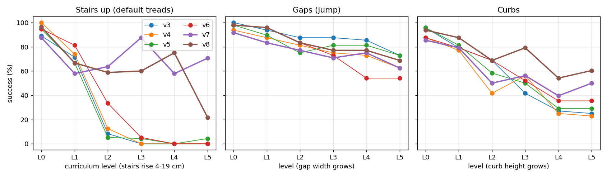

# Experiment log: how the autonomous-skills policy was built

*Written 2026-11-11. This is the scientific record of the reinforcement-learning work: what was tried, what
happened, why, how it was fixed, and which decisions followed. Numbers come from `skill_eval.json` of each run
(`experiments/<run>/`); "success" = no fall and at least 2.5 m covered in 12 s. For the current state and the
plan, see [status_and_plan.md](status_and_plan.md). For the controller itself, see
[model_and_control.md](model_and_control.md).*



## 0. Context and method

PRIMUS balances on two wheels with a model-based controller (LQR scheduled on leg length + VMC through the
closed 5-bar Jacobian). The learned policy is a **residual** on top of it: it never outputs motor torques, it adds
small corrections (leg length, leg angle, wheel torque, leg force) and, for the skills, one extra action that
**triggers a jump primitive** (push both legs out, then tuck them). Training: PPO (RSL-RL 5.4) on 4096 robots in
MuJoCo Warp, ~45k policy steps/s on one GPU. The teacher sees privileged information (a perfect height scan of the
ground ahead, true velocity, motor limits); a student is meant to be distilled from it using only the simulated
camera map.

Rule used throughout: every policy is evaluated per terrain type and per curriculum level against the controller
alone, on identical scenarios (`skill_eval.py`).

## 1. Lessons before the skills (Oct 2026)

| Date | Experiment | Outcome | Lesson / decision |
|---|---|---|---|
| 2026-10-31 | Isaac Sim, PPO on raw motor torques | the robot lowered the landing gear and sat on it | reward paid ~full for a tilted robot, lenient termination, gear target never set. Do not learn balance from scratch next to a working LQR. Details: [terrain-run-2026-10-31.md](terrain-run-2026-10-31.md) |
| 2026-10-31 | **Residual** PPO on the LQR, MuJoCo Warp (warp-residual-v2) | falls/min 0.265 → 0.069, speed error 0.207 → 0.094 m/s | residual keeps the safe base and trains in 50 min. Exploration noise must be bounded: when std grew to 0.66 falls went from 2% to 75% |

## 2. Skill teacher, v1 to v8

Terrain: tiles of 8 m, 6 curriculum levels per type (flat, rough, slope, stairs, curbs, gaps, overhang, later
wide-tread stairs). Stairs rise 4/7/10/13/16/19 cm; the real stairs are ~17 cm, the wheel radius is 10.75 cm, so
from ~10 cm a step cannot be rolled over, it needs a two-wheel jump (the robot has no hip abduction, so it cannot
climb one leg at a time).

### v1: no jump primitive (stopped at 1500 iterations)
- **Result:** stairs down 80% → 87–100%, gaps up to 31 cm and curbs clearly better than the controller alone.
  Stairs **up** only at 4 cm (100%) and 7 cm (26%); from 10 cm the robot stays at the foot.
- **Why:** exploration noise collapsed to its floor (std 0.07). A two-wheel jump is a coordinated pulse of
  extension and tuck; random noise never produces it.
- **Decision:** give the controller a jump primitive and let the policy only decide *when* (trigger), keep std ≥ 0.1.

### v2: jump primitive
- Primitive in `control/repo_control_policy.py`, mirrored in the Warp kernel (parity test). Measured alone: the
  wheels clear 23–29 cm at 18–20 N·m, ~35 cm at 25 N·m.
- **Result:** gaps 31–45 cm 69–73% (v1: 31–62%), bars to 52 cm free height 83%, stairs up 7 cm 58%, **0% from 10 cm**.
- **Why:** climbing one or two steps earned nothing unless the robot covered 2.5 m. Sparse reward, no gradient.
- **Decision (v3):** dense `climb` reward (every new ground height under the wheels, only while grounded) and
  level-up after 3 steps climbed.

### v3 (4000 iterations)
Stairs up 7 cm 71%, 10 cm+ still ~0–8%. Stairs down 89–97%, gaps to 45 cm 73–100%, bars 79–100%, curbs 25–96%.
First camera **student** (distilled from v3): near the teacher on stairs down, curbs, bars, but gaps from 24 cm
collapse (0–17% vs 73–88%): with a level camera the inside of a gap and the treads past an edge are never seen
and the near field is blind (~0.85 m), so jump timing depends on memory and drift.

### v4 to v6: policy-shaped jump, then wide treads
- **v4:** 12 actions, the policy also chooses extension, push force and tuck length (latched at the trigger),
  climbing focus (70% of stairs robots climb), 20 s episodes, climb reward ×2. Initialised from v3 with remapped
  weights (exact to 4e-7). Stairs up still ≤ 12% from 10 cm.
- **v5:** 3000 more iterations of v4. No improvement on stairs up (0–5% from 13 cm). Continuing a policy that
  has already settled into "do not jump" does not recover the behaviour.
- **v6:** added wide-tread stairs (0.50 m): room to land and chain jumps. Stairs up 10 cm 33% (v5: 5%), wide
  stairs 13 cm 45%, 19 cm only 13%.
- **GRU student** from v5 (recurrent, camera map): trained for the perception route (not evaluated against v7/v8); its quality is bounded by the
  teacher it copies, so student work waits for a better teacher.
- **Diagnosis after v6:** the continued runs carry habits. Decision: retrain **from scratch** with a new
  architecture and the final action space.

### v7: from scratch, `encoders` architecture (10 000 iterations, 6.7 h)
- Separate encoders for the scan (155→128→32), ceiling (45→32→8) and privileged vector (8→32→8), then an MLP
  512-256-128. Stairs up on real 30 cm treads: 4.1 / 4.6 / 3.7 / 2.6 of 5 steps at 10/13/16/19 cm
  (v6: 2.3 / 1.0 / 1.1 / 0.7). Best numbers so far.
- **But the videos showed behaviour the real robot cannot do:**
  1. an upper-arm link turning a full circle (hips had no limits, the 5-bar folded through itself);
  2. legs split ~60° on the way down (the leg-angle residual allowed it at no cost);
  3. jumps always at full push with an ideal motor (peak power ~675 W, leg speed ~4.5 m/s, far above the battery
     and the actuators).
- **Decision:** results from v7 are not trustworthy for sim-to-real. Keep the architecture, fix the physics.

### v8: realistic hips and motors (10 000 iterations, 7 h) — current best teacher
Changes, all aimed at removing "free" physics:
- hip joint limits from the CAD (`model.HIP_RANGE_DEG`: hip_Yp −49..118°, hip_Ym −124..47°);
- motor model in the kernel: torque limit drawn per robot (18–25 N·m) with speed droop W0 ×0.8–1.05, torque lag
  1–4 ms, action delay 0–10 ms, battery power limit 500–900 W, gearbox friction. Electrical estimates:
  `hardware/actuators.json` (`estimates_2026_11_10`);
- push force 130–250 N, leg-angle residual ±0.35 rad;
- new costs: hip-limit proximity (−20), leg split above ~0.2 rad (−3), positive power (−0.002), leg extension
  speed above 2.5 m/s (−0.5), climb reward 40.

**Result.** Movement became plausible: peak power 340–380 W (v7 ~675), extension 2.5–3.1 m/s (v7 ~4.5), median
leg split 15°, no spinning links. Success by level (0→5):

| terrain | v8 success (%) |
|---|---|
| stairs up | 96 / 67 / 59 / 60 / 75 / **22** |
| stairs down | 100 / 88 / 90 / 86 / 93 / 80 |
| curbs | 94 / 88 / 69 / 79 / 54 / 60 |
| gaps | 98 / 96 / 83 / 77 / 77 / 69 |
| stairs, wide treads, up | 100 / 88 / 86 / 88 / 91 / 47 |

Steps climbed (of 5) at 4–19 cm: 4.7 / 4.3 / 3.1 / 4.3 / 4.1 / 2.5. Cost of realism: the 19 cm stairs (the real
17 cm stairs are between level 4 and 5) dropped from 71% (v7, ideal motors) to 22%.

| 19 cm stairs: v8 fails | 45 cm gap: v8 crosses |
|---|---|
|  |  |

## 3. Diagnosis: why v8 never uses the jump, and what the jump can do

User observation (v7 vs v8): the robot rolled and shuffled up the stairs, never jumping, even on gaps. Three tests
on the final v8 checkpoint answered it.

1. **Trigger usage by terrain** (`probe.py`): the jump trigger fired essentially never on stairs or gaps.
   Reason: the trigger action's mean sat near −0.22 and the global std floor was 0.1, so the 0.5 threshold was
   **~7σ away**. Exploration of the jump had died, the same failure as v1 at a smaller scale. With a realistic
   motor the jump is also a risky, low-reward-difference option compared with creeping over a step.
2. **Maximum jump with the realistic motor model** (`maxjump.py`; flat ground, standing, extension 0.52 m, tuck
   0.18 m, start leg 0.25 m): wheel clearance **24 cm** (18 N·m, W0×0.8, 500 W) to **33 cm** (25 N·m, W0×1.05,
   900 W); airtime 0.16–0.20 s. Most of the clearance comes from the tuck, the CoM itself rises little.
   So a 17 cm step is jumpable even with the weakest motor draw, but with little margin and no room for error in
   timing.
3. **Scripted hop** (open-loop push-tuck at a fixed distance before the step, LQR only; `scripted.py`,
   `search.py`, `trace.py`): at best ~2 of 5 steps, many configurations did not jump at all (the primitive only
   starts if `avg_len < ext − 0.05`, so a 0.40 m extension from a 0.35 m leg never fires; this also produced
   misleading "no-fall" scores in the first random search). Conclusion: a blind scripted hop is not viable; the
   policy must learn timing and recovery.

**Target behaviour (user decision):** a hop that lands *flush* on the next step with both wheels together, judged
more stable than one wheel at a time. Gaps, and later larger gaps and equestrian-style hurdles, must keep working
or be trained.

## 4. v9: teaching the hop (in progress)

Hypothesis: the jump is never discovered because exploration cannot reach the trigger; if the rollout shows PPO the
outcome of hops near step edges, the policy will learn to use them. Changes:

**Terrain** (`skill_terrain.py`, new types appended so old indices are unchanged): `hurdles` (thin walls 6–24 cm
in three square rings), `gaps_wide` (30–80 cm), `stairs_long` (8 steps). Spawn weights rebalanced
(`type_weights`), fast commands (0.8–1.6 m/s) on hurdles and wide gaps, long flights need 6 steps to level up.

**Reward** (`skill_env.py`): `hop_climb` = 15 × height gained while a hop is in flight or within 1 s of it. The
hop is exempt from the penalties that would otherwise forbid it: vertical speed, positive power and extension
speed are masked for 0.3 s after a jump (`since_jump`).

**Exploration by injection** (`skill_model.py`, `SkillTeacherModel._inject_hops`): in rollouts only, where the
centre column of the scan shows a step edge (rise 5–30 cm, 0.15–0.45 m ahead) or a trench edge, and the robot stands
on level ground, a few percent of steps (3% decaying to 1% over the first 60% of training; trenches half as
often) replace the trigger action with 0.65. The stored action is the injected one, so PPO credits the outcome to
the trigger. Frequency per terrain was measured first (`inj.py`): 0% on flat and rough ground, ~1–5% of the time
on terrains with edges. The first version also fired on gaps, rough ground, slopes and overhangs; edge
detection by differences between neighbouring scan cells fixed that.

**Initialisation:** from v8 (`--init-from`, 7000 iterations planned), acceptance criteria agreed with the user:
stairs up at 19 cm clearly above 22%, and gaps no worse than v8. v8 baseline on the new terrains (level 0 → 5):
hurdles 63→3%, gaps_wide 68→0%, stairs_long up 100→19%.

### Failures during v9, and fixes

| # | Symptom | Cause | Fix |
|---|---|---|---|
| 1 | Run 1 crashed at iteration 419: `RuntimeError: normal expects all elements of std >= 0.0` (NaN policy). Noticed because the GPU was idle | the injection also replaced the jump *shape* actions (extension, push, tuck) with random values up to **12σ** from the policy distribution; the log-probability gradient of such samples blew the weights up | inject only the trigger (0.65), keep the policy's own shape samples; std floor 0.25 on actions 8–11 (the injected trigger sits ~2σ from the mean) |
| 2 | Run 2 crashed at iteration ~660, same error. One batch had `surrogate loss` 20151 (importance ratio ~1e5), two steps later NaN | even a trigger at 3–4σ gives a huge ratio exp(Δlogp) for negative-advantage samples after a small policy shift; PPO clips the ratio only on one side | cap the log-ratio at 1.5 inside PPO's loss (`train.py`: replaces `torch.exp` in `rsl_rl.algorithms.ppo` for the skills task, so one outlier cannot dominate), std floor 0.3, resumed from checkpoint 500 |

Run 3 passed the previous crash point (iteration 660) cleanly. It is expected to finish in about 4.5 h.
Early training signals (iteration 90): `Metrics/fell` ≈ 0.55 (high on purpose: new hard terrains and hops),
`hop_climb` ≈ 0.011 and growing; surrogate loss normal.

**Open risks:** the injection may hurt gaps that v8 solves by rolling through (watch gaps/stairs falls around
iteration ~1500); whether the policy keeps hopping after the injection probability anneals to 1% is unknown; hop
timing may not transfer to the student's camera map (blind near field).

## 5. Other experiments

**Stand up after a fall (`recovery_env.py`).** v1 never parked (target leg length 0.18 m at the action limit, pose
reward too narrow, no gradient). v2: 99.1% of 10 979 episodes parked, median 2.0 s. v3 trains from 75–180° (side
falls and upside down): 98.4% of 9 621, median 2.1 s. On CPU with full CAD collision, front/back falls stand up in
0.9–1.2 s. Known limit: a few side falls end leaning at ~55° and the policy cannot leave that pose.

**Perception stack** (`perception/`): D435i → elevation map with memory → features (stairs, curbs, drops, gaps,
overhangs) → planner and edge guard; RPLIDAR A1 for obstacles; body pitch to look (`RobotCommand.pitch_ref`).
Through the full CPU stack the exported v1 descended 13 cm stairs and crossed 17 cm gaps from rendered depth.

## 6. What the sequence taught us (for the write-up)

1. **Residual over a model-based controller** gave stable training from step 0 and a safe fallback; the
   from-scratch raw-torque run failed by exploiting the reward.
2. **Exploration of coordinated, rare behaviours** (the jump) is the central problem, seen three times: v1 (std
   collapse), v8 (trigger 7σ from threshold) and v9 (injection outliers). Fixes that worked: a primitive that
   packs the pulse into one action, a bounded std floor, and targeted exploration where the geometry says a hop
   is useful.
3. **Simulator freedom flatters results.** v7's best numbers came from motors and joints the robot does not have;
   removing that cost 50 percentage points on the hardest stairs. Reporting v7 as the capability would have been
   wrong.
4. **Continuing a policy does not repair its habits** (v4→v6); retraining from scratch with a better architecture
   (v7) gave the largest jump in capability.
5. **Off-policy injected data needs care in PPO**: unbounded importance ratios are the failure mode, so bound both
   the injected values (σ-distance) and the ratio.
6. **Perception limits the student, not only the teacher**: a level camera cannot see the inside of a gap; jump
   timing then depends on memory and odometry drift.

## 7. Reproducing

```bash
# teacher (v9 recipe, from v8)
~/test/isaac-rl/bin/python sim/warp_rl/train.py --task skills --arch encoders --num-envs 4096 \
    --iterations 7000 --name skill-teacher-v9 --init-from <v8>/logs/model_9999.pt
~/test/isaac-rl/bin/python sim/warp_rl/skill_eval.py --checkpoint <run>/logs/model_N.pt --arch encoders --out <run>
~/test/isaac-rl/bin/python sim/warp_rl/export_policy.py --task skills --arch encoders --checkpoint <run>/logs/model_N.pt
MUJOCO_GL=egl python3 sim/scripts/record_skill_video.py out.mp4 --policy <run>/exported --tile stairs --level 5
```

Experiment directories (checkpoints, logs, `experiment.json` with arguments and git revision, TensorBoard) live
outside this repository in `experiments/`. The analysis scripts of section 3 were temporary and are described, not
shipped.
