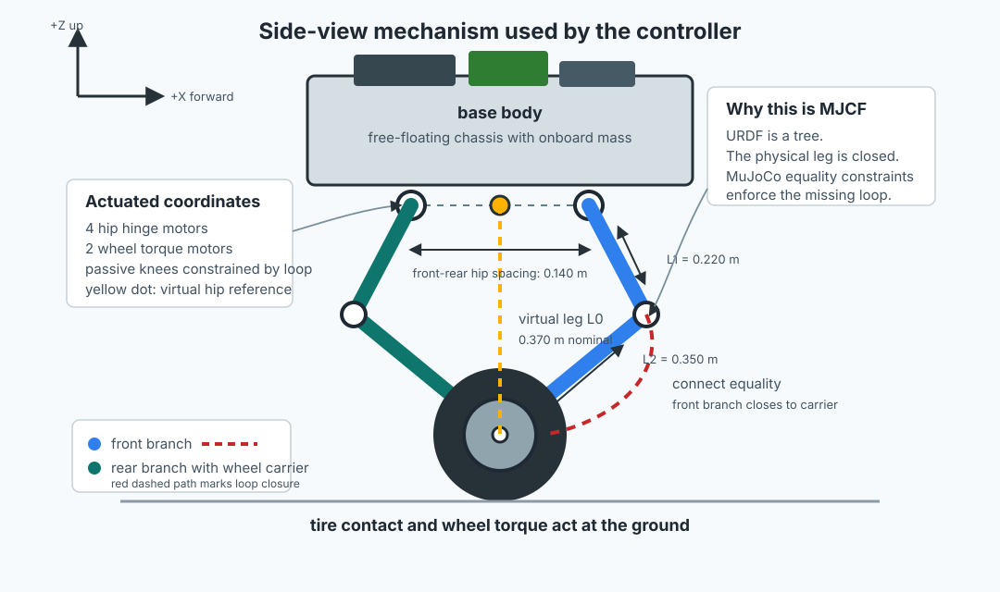
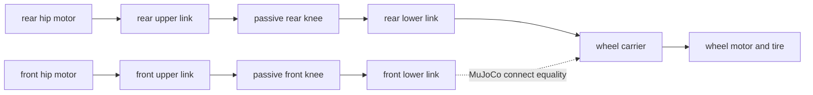
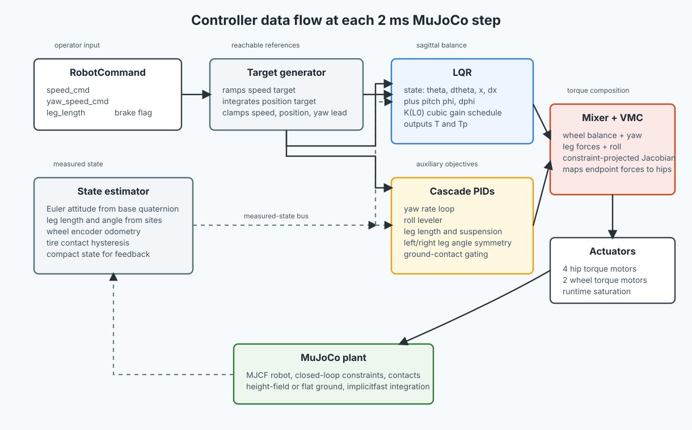
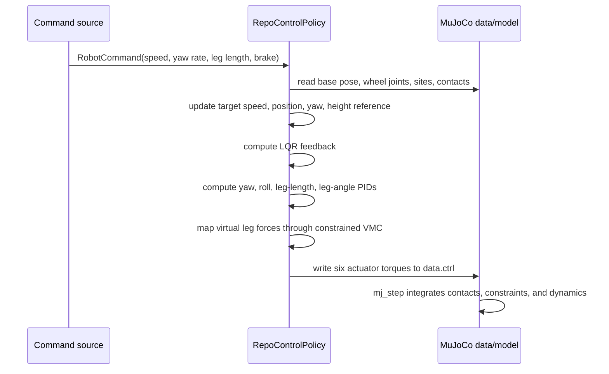

# Robot System Explained: Mechanism, Control, and Simulation

This document is a textbook-style explanation of the current project. It assumes
the reader is comfortable with dynamics, state feedback, PID control, and robot
simulation, but has not seen this repository before.

The short version is this: the project simulates a two-wheeled, wheel-legged
inverted pendulum in MuJoCo. Each side has a closed five-bar leg that changes
the wheel axle position relative to the body. The wheels balance and drive the
robot in the sagittal plane, while four hip motors shape the leg forces,
support the body, adjust ride height, reject roll, and keep the two legs from
splaying during yaw. The simulation is intentionally built from simple MJCF
primitive geometry so that the controller, constraints, and contact behavior
remain inspectable.

## 1. Project Intent

The repository is not a polished CAD import. It is a control and simulation
testbed for a larger wheel-legged robot inspired by the control structure of
`Skythinker616/foc-wheel-legged-robot`.

The design goal is:

1. Keep the reference controller architecture: LQR balance, virtual model
   control (VMC), cascade PID loops, wheel odometry, and ground contact gating.
2. Replace small-reference-robot numerical assumptions with this larger
   robot's dimensions, masses, wheel radius, and leg range.
3. Use MuJoCo features that URDF cannot provide cleanly, especially equality
   constraints for closed leg loops.
4. Provide repeatable scripts for loading, viewing, driving, diagnosing, and
   quantifying balance behavior.

The main files are:

| File | Role |
| --- | --- |
| `scripts/generate_mjcf.py` | Source of truth for robot geometry, terrain, constraints, actuators, sensors, and the generated MJCF files. |
| `models/pro_wheel_legged_robot.xml` | Generated arena model with height-field terrain and obstacles. |
| `models/pro_wheel_legged_robot_flat.xml` | Generated obstacle-free model used for clean control measurements. |
| `scripts/repo_control_policy.py` | Main controller: LQR, VMC, cascade PIDs, odometry, ground hysteresis, target generation. |
| `scripts/lqr_design.py` | Re-derives the LQR gain schedule from a linearized dynamic model. |
| `scripts/lqr_gains.py` | Generated cubic LQR gains imported by the runtime controller. |
| `scripts/run_viewer.py` | Passive MuJoCo viewer with zero command. |
| `scripts/run_xbox_viewer.py` | Passive MuJoCo viewer driven by a wireless Xbox controller. |
| `scripts/check_model.py` | Loads the model, lists joints and actuators, and runs a 5 s balance sanity check. |
| `scripts/analyze_balance.py` | Quantitative swing and stability metrics. |
| `scripts/diagnose.py` | Headless trajectory printout for quick tuning diagnosis. |

## 2. Coordinates and Physical Abstraction

The project uses a conventional robot body frame:

| Axis | Meaning |
| --- | --- |
| `+X` | forward |
| `+Y` | left |
| `+Z` | up |

All generated MuJoCo dimensions are in meters. The base starts at
`z = 0.4775 m`, which is the nominal virtual hip-to-axle length plus the wheel
radius:

```text
base_z = abs(WHEEL_AXLE_Z) + WHEEL_RADIUS
       = 0.370 + 0.1075
       = 0.4775 m
```

The side-view abstraction below is the mental model used by the controller.



Important nominal dimensions:

| Quantity | Value |
| --- | ---: |
| Chassis envelope | `0.220 x 0.300 x 0.080 m` |
| Front hip x offset | `+0.070 m` |
| Rear hip x offset | `-0.070 m` |
| Sagittal front-rear hip spacing | `0.140 m` |
| Upper link length | `0.220 m` |
| Lower link length | `0.350 m` |
| Wheel radius | `0.1075 m` |
| Wheel diameter | `0.215 m` |
| Wheel width | `0.060 m` |
| Wheel center track | `0.368 m` |
| Nominal virtual leg length | `0.370 m` |
| Nominal base height | `0.4775 m` |

The live MuJoCo model currently reports total body mass `12.96 kg`. The mass is
distributed over chassis, electronics, hip drive modules, links, carriers, and
wheels. Some decorative shapes have zero mass on purpose: they provide visual
orientation without corrupting inertia or gravity compensation.

## 3. Why the Robot Is Modeled This Way

The robot is a two-wheeled inverted pendulum with variable-length legs. A normal
two-wheeled balancer must move its wheel contact points under the center of mass
to avoid falling forward or backward. This robot adds a second control layer:
the wheel axles can move relative to the chassis, so the controller can change
ride height, absorb terrain, and generate roll or leg-angle corrections.

The simulation deliberately uses primitives:

- boxes for the chassis, electronics, wheel carriers, and terrain obstacles;
- capsules for the upper and lower leg links;
- cylinders for wheels, hip drive modules, lidar, and humps;
- a grayscale height field for natural terrain.

This exists for engineering reasons. Primitive geometry loads quickly, has
stable contact behavior, and makes controller bugs easier to isolate. A detailed
mesh import would look better, but it would make mass, collision, and contact
debugging harder before the control design is settled.

## 4. The Closed Five-Bar Leg

Each side of the robot is a closed linkage. In physical terms, one wheel carrier
is supported by two branches:



In MJCF, the robot must still be represented as a tree of bodies. The generated
tree attaches the wheel to the rear branch. The front branch is closed to the
same carrier using MuJoCo `equality/connect` constraints:

```xml
<connect name="left_front_branch_to_carrier"
         body1="left_front_lower"
         body2="left_wheel_carrier"
         anchor="0.35 0 0" />
```

The anchor is the tip of the front lower link in the front-lower body's local
frame. This detail matters. If the anchor is accidentally interpreted as a world
point, the constraint can look numerically satisfied while the visible linkage
pulls apart. The current generator uses the local point `(LOWER_LINK_LENGTH, 0,
0)`, exactly where the loop site is placed.

This is the main reason the project uses MuJoCo MJCF instead of URDF. URDF is a
tree description. It cannot directly enforce this closed loop as a physical
constraint in the same way.

## 5. Joints, Actuators, and Passive Coordinates

The loaded model has:

| Model property | Current value |
| --- | ---: |
| Generalized positions `nq` | `17` |
| Generalized velocities `nv` | `16` |
| Actuators `nu` | `6` |
| Bodies | `14` |
| Joints | `11` |
| Geometries | `47` |
| Equality constraints | `2` |
| Timestep | `0.002 s` |

The joints are:

- one floating base joint;
- four active hip hinge joints;
- four passive knee hinge joints;
- two active wheel hinge joints.

The actuators are torque-input MuJoCo motors:

| Actuator | Joint | MJCF force range | Runtime clamp |
| --- | --- | ---: | ---: |
| `left_front_hip_motor` | `left_front_hip` | `+-500 Nm` | `+-480 Nm` |
| `left_rear_hip_motor` | `left_rear_hip` | `+-500 Nm` | `+-480 Nm` |
| `right_front_hip_motor` | `right_front_hip` | `+-500 Nm` | `+-480 Nm` |
| `right_rear_hip_motor` | `right_rear_hip` | `+-500 Nm` | `+-480 Nm` |
| `left_wheel_motor` | `left_wheel` | `+-150 Nm` | `+-140 Nm` |
| `right_wheel_motor` | `right_wheel` | `+-150 Nm` | `+-140 Nm` |

The knees are passive because the physical closed mechanism determines their
motion once the two hip angles and the wheel carrier pose are known. In the
simulation, MuJoCo's constraint solver enforces that relationship.

## 6. What the Controller Sees

The controller does not operate on all MuJoCo coordinates directly. It reduces
the simulation state to variables with physical meaning.

### 6.1 Base attitude

`RepoControlPolicy` reads the floating base quaternion and converts it to roll,
pitch, and yaw:

```text
roll, pitch, yaw = quat_to_euler_wxyz(data.qpos[3:7])
```

For the sagittal balance LQR, `pitch` is the body lean angle. In the LQR state
notation used by this project, it is called `phi`.

### 6.2 Leg length and leg angle

For each side, the policy reads the world positions of two MuJoCo sites:

- the virtual hip site;
- the wheel center site.

It rotates the vector from hip to wheel into the base frame. If that local
vector is `(dx, 0, dz)`, then:

```text
L = sqrt(dx^2 + dz^2)
alpha = atan2(-dz, dx)
```

At nominal standing height, `dx` is near zero and `dz` is negative, so
`alpha` is near `pi/2`. The control variable `theta` is a calibrated leg-swing
angle relative to the body:

```text
theta = average_leg_angle - pi/2 - pitch - theta_zero
```

`theta_zero` is captured at reset so the robot's starting build pose is treated
as neutral.

### 6.3 Wheel odometry

The controller uses wheel encoder odometry for forward distance and speed:

```text
x  = R/2 * (q_left_wheel  + q_right_wheel)
dx = R/2 * (dq_left_wheel + dq_right_wheel)
```

This is better than using world `qpos[0]`. Once the robot yaws, its forward
direction is no longer world `+X`. Wheel odometry measures distance along the
robot's own rolling direction, so drive control remains correct while turning.

### 6.4 Contact state

Only the tires collide with the environment. If either tire is in a MuJoCo
contact pair, that tire is considered recently grounded. The robot is grounded
when both tires have touched within a short grace window:

```text
air_grace_steps = 30
grace_time = 30 * 0.002 s = 0.060 s
```

This hysteresis exists because height-field terrain can produce one-step
micro-hops. Without hysteresis, the balance wheel torque would flicker off on
contact dropouts and create visible swing.

## 7. The Control Stack

The controller is easier to understand as stacked loops. Some loops generate
wheel torques, some generate leg forces, and some map virtual leg commands into
real hip torques.



One control tick does the following:



The policy runs at the MuJoCo timestep, `dt = 0.002 s`.

## 8. Mathematical Model and Algorithms

This section is the mathematical core of the controller. The code uses MuJoCo's
full generalized state internally, but the control law is built on a smaller
set of physically meaningful variables.

### 8.1 Reduced State From the MuJoCo State

MuJoCo evolves generalized coordinates and velocities:

$$
q \in \mathbb{R}^{n_q}, \qquad v \in \mathbb{R}^{n_v}.
$$

For this model, `nq = 17` and `nv = 16`. The controller does not design
feedback directly on all of them. It extracts:

$$
z =
\begin{bmatrix}
\theta & \dot{\theta} & x & \dot{x} & \phi & \dot{\phi}
\end{bmatrix}^{\mathsf{T}},
$$

where:

| Symbol | Code variable | Meaning |
| --- | --- | --- |
| $\theta$ | `theta` | average fore-aft leg angle relative to body pitch |
| $\dot{\theta}$ | `d_theta` | leg-swing rate relative to body pitch rate |
| $x$ | `state_x` | body-frame forward wheel odometry |
| $\dot{x}$ | `state_dx` | body-frame forward wheel speed |
| $\phi$ | `pitch` | chassis pitch |
| $\dot{\phi}$ | `pitch_rate` | chassis pitch rate |

For each side $i \in \{L,R\}$, let the virtual hip and wheel-center positions in
world coordinates be $p_{h,i}^W$ and $p_{w,i}^W$. Let $R_B^W$ be the rotation
matrix from body frame to world frame. The wheel vector expressed in the body
frame is:

$$
r_i^B =
\begin{bmatrix}
d_{x,i} \\ d_{y,i} \\ d_{z,i}
\end{bmatrix}
= (R_B^W)^{\mathsf{T}}(p_{w,i}^W - p_{h,i}^W).
$$

The controller only uses the sagittal components:

$$
\ell_i = \sqrt{d_{x,i}^2 + d_{z,i}^2},
\qquad
\alpha_i = \operatorname{atan2}(-d_{z,i}, d_{x,i}).
$$

The average virtual leg length and angle are:

$$
\ell = \frac{\ell_L + \ell_R}{2},
\qquad
\alpha = \frac{\alpha_L + \alpha_R}{2}.
$$

At reset, the controller stores a neutral offset $\theta_0$. During control:

$$
\theta = \alpha - \frac{\pi}{2} - \phi - \theta_0,
\qquad
\dot{\theta} = \dot{\alpha} - \dot{\phi}.
$$

This definition is important. The LQR does not regulate raw leg angle; it
regulates leg swing relative to the pitched chassis.

### 8.2 Wheel Encoder Odometry

Let $q_L, q_R$ be the left and right wheel joint angles, and let
$\dot{q}_L, \dot{q}_R$ be their velocities. With wheel radius $R_w = 0.1075$ m,
the body-frame rolling odometry is:

$$
x = \sigma_x \frac{R_w}{2}(q_L + q_R),
\qquad
\dot{x} = \sigma_x \frac{R_w}{2}(\dot{q}_L + \dot{q}_R).
$$

The sign $\sigma_x$ is `wheel_odom_sign`, currently $+1$. This is the same idea
as differential-drive odometry, except only the average wheel motion is used for
forward balance. Yaw comes from the difference between left and right wheel
torques, not from this scalar odometry state.

### 8.3 Contact Hysteresis

The balance torque is meaningful only when both tires are effectively on the
ground. The raw contact signal for tire $i$ is:

$$
c_i[k] =
\begin{cases}
1, & \text{if tire } i \text{ appears in any MuJoCo contact pair at step } k,\\
0, & \text{otherwise.}
\end{cases}
$$

The controller keeps an integer air counter $a_i[k]$:

$$
a_i[k] =
\begin{cases}
0, & c_i[k] = 1,\\
a_i[k-1] + 1, & c_i[k] = 0.
\end{cases}
$$

A tire is treated as grounded if:

$$
a_i[k] \leq N_{\text{grace}},
\qquad
N_{\text{grace}} = 30.
$$

Since the timestep is $2$ ms, this is a $60$ ms grace window. The whole robot is
grounded when both tires are recently grounded:

$$
g[k] =
\mathbf{1}
\left[
a_L[k] \leq N_{\text{grace}}
\ \land\
a_R[k] \leq N_{\text{grace}}
\right].
$$

This is not merely a software convenience. It changes the closed-loop behavior:
without hysteresis, terrain micro-hops turn the wheel-balancing controller into
an on/off system.

### 8.4 Target Generator

Let the user command forward speed $v_c$ and yaw rate $\omega_c$. The controller
keeps internal targets $v_t$, $x_t$, and $\psi_t$ for speed, position, and yaw.

The ordinary speed target update is a saturated ramp:

$$
v_t[k+1] =
v_t[k] +
\operatorname{clip}
\left(
v_c[k] - v_t[k],
-\Delta v_{\max},
\Delta v_{\max}
\right),
$$

with:

$$
\Delta v_{\max}
=
\max
\left(
0.003\frac{\Delta t}{0.004},
\left(0.010 - 0.02(\ell-\ell_0)\right)\frac{\Delta t}{0.004}
\right).
$$

The position target integrates the speed target:

$$
x_t[k+1] = x_t[k] + \Delta t\, v_t[k+1].
$$

Then both targets are clamped around the measured state:

$$
x_t[k+1]
=
\operatorname{clip}
\left(
x_t[k+1],
x[k] - x_{\text{lead}},
x[k] + x_{\text{lead}}
\right),
$$

$$
v_t[k+1]
=
\operatorname{clip}
\left(
v_t[k+1],
\dot{x}[k] - v_{\text{lead}},
\dot{x}[k] + v_{\text{lead}}
\right).
$$

The current values are:

$$
x_{\text{lead}} = 0.18\ \text{m},
\qquad
v_{\text{lead}} = 0.7\ \text{m/s}.
$$

During a hard brake, the algorithm deliberately violates the normal ramp:

$$
v_t[k+1] = 0,
\qquad
x_t[k+1] = x[k],
\qquad
v_{\text{lead}} = 3.0\ \text{m/s}.
$$

That gives the LQR a large velocity error immediately, which produces strong
deceleration torque.

For yaw, the command is a rate command. While $|\omega_c|$ is nonzero, the yaw
target is pinned to the measured yaw $\psi$ so the heading loop cannot wind up:

$$
\psi_t[k] = \psi[k]
\qquad
\text{when } |\omega_c[k]| > 10^{-3}.
$$

When the stick is released, $\psi_t$ is held near the current yaw:

$$
\psi_t[k+1]
=
\operatorname{clip}
\left(
\psi_t[k],
\psi[k] - \psi_{\text{lead}},
\psi[k] + \psi_{\text{lead}}
\right).
$$

### 8.5 Planar Dynamics Used for LQR Design

The LQR design is not derived from the full MuJoCo model. It uses a planar
model matching the reference controller's derivation. The state is:

$$
s =
\begin{bmatrix}
\theta & \dot{\theta} & x & \dot{x} & \phi & \dot{\phi}
\end{bmatrix}^{\mathsf{T}},
\qquad
u =
\begin{bmatrix}
T & T_p
\end{bmatrix}^{\mathsf{T}}.
$$

Here $T$ is wheel torque and $T_p$ is the virtual hip torque. The design
parameters are:

| Symbol | Code key | Meaning |
| --- | --- | --- |
| $R_w$ | `R` | wheel radius |
| $m_w$ | `mw` | combined wheel mass |
| $m_p$ | `mp` | combined leg-link mass |
| $M$ | `M` | main body mass |
| $I_w$ | `Iw` | combined wheel inertia |
| $I_p$ | `Ip` | leg inertia approximation |
| $I_m$ | `Im` | body pitch inertia |
| $L$ | `L` | half of virtual leg length |
| $L_m$ | `Lm` | other half of virtual leg length |
| $l$ | `l` | body CoM offset term |

The script solves for accelerations $\ddot{x}$, $\ddot{\theta}$, and
$\ddot{\phi}$ from three residual equations. It first defines horizontal and
vertical reaction terms for the body:

$$
N_m =
M
\left[
\ddot{x}
+ (L+L_m)(\ddot{\theta}\cos\theta - \dot{\theta}^2\sin\theta)
- l(\ddot{\phi}\cos\phi - \dot{\phi}^2\sin\phi)
\right],
$$

$$
P_m =
Mg
+ M
\left[
(L+L_m)(-\dot{\theta}^2\cos\theta-\ddot{\theta}\sin\theta)
- l(\dot{\phi}^2\cos\phi+\ddot{\phi}\sin\phi)
\right].
$$

Then it adds the leg-link contribution:

$$
N =
N_m
+ m_p
\left[
\ddot{x}
+ L(\ddot{\theta}\cos\theta-\dot{\theta}^2\sin\theta)
\right],
$$

$$
P =
P_m
+ m_p g
+ m_p L(-\dot{\theta}^2\cos\theta-\ddot{\theta}\sin\theta).
$$

The three equations are:

$$
0 =
\ddot{x}
-
\frac{T - N R_w}{I_w/R_w + m_w R_w},
$$

$$
0 =
(P L + P_m L_m)\sin\theta
-
(N L + N_m L_m)\cos\theta
- T + T_p
- I_p\ddot{\theta},
$$

$$
0 =
T_p
+ N_m l\cos\phi
+ P_m l\sin\phi
- I_m\ddot{\phi}.
$$

These equations are nonlinear in the state, but affine in the three
accelerations. `lqr_design.py` evaluates the residual at zero acceleration and
at unit accelerations to recover the linear system in:

$$
a =
\begin{bmatrix}
\ddot{x} & \ddot{\theta} & \ddot{\phi}
\end{bmatrix}^{\mathsf{T}},
$$

then solves:

$$
J_a a = -r_0.
$$

After accelerations are found, the continuous state derivative is:

$$
\dot{s}
= f(s,u)
=
\begin{bmatrix}
\dot{\theta}\\
\ddot{\theta}\\
\dot{x}\\
\ddot{x}\\
\dot{\phi}\\
\ddot{\phi}
\end{bmatrix}.
$$

### 8.6 Linearization, Discretization, and DARE

For each sampled leg length $L_0$, the script sets:

$$
L = L_m = \frac{L_0}{2}.
$$

It numerically linearizes the dynamics around the upright equilibrium:

$$
A_{ij}
=
\frac{
f_i(s_0 + \varepsilon e_j, u_0)
-
f_i(s_0 - \varepsilon e_j, u_0)
}{2\varepsilon},
$$

$$
B_{ij}
=
\frac{
f_i(s_0, u_0 + \varepsilon e_j)
-
f_i(s_0, u_0 - \varepsilon e_j)
}{2\varepsilon},
$$

where:

$$
s_0 = 0, \qquad u_0 = 0, \qquad \varepsilon = 10^{-6}.
$$

It converts the continuous model to a discrete zero-order-hold model with the
block matrix exponential:

$$
\exp
\left(
\begin{bmatrix}
A & B\\
0 & 0
\end{bmatrix}
\Delta t
\right)
=
\begin{bmatrix}
G & H\\
0 & I
\end{bmatrix}.
$$

So the discrete model is:

$$
s_{k+1} = Gs_k + Hu_k.
$$

The LQR minimizes:

$$
J =
\sum_{k=0}^{\infty}
\left(
s_k^{\mathsf{T}} Q s_k
+
u_k^{\mathsf{T}} R u_k
\right).
$$

The discrete algebraic Riccati equation is:

$$
P =
G^{\mathsf{T}}PG
-
G^{\mathsf{T}}PH
(R+H^{\mathsf{T}}PH)^{-1}
H^{\mathsf{T}}PG
+ Q.
$$

The optimal gain is:

$$
K =
(R+H^{\mathsf{T}}PH)^{-1}H^{\mathsf{T}}PG,
\qquad
u_k = -Ks_k.
$$

### 8.7 Gain Scheduling by Leg Length

The LQR gain changes with leg length. The script samples:

$$
L_0 \in \{0.24, 0.25, \dots, 0.52\}\ \text{m}
$$

and computes a gain matrix $K(L_0)$ at every sample. Each scalar gain entry is
fit with a cubic:

$$
K_{ij}(L_0)
=
c_{ij,3}L_0^3
+ c_{ij,2}L_0^2
+ c_{ij,1}L_0
+ c_{ij,0}.
$$

Equivalently, for each entry:

$$
c_{ij}
=
\arg\min_c
\sum_n
\left(
K_{ij}(L_{0,n})
-
\begin{bmatrix}
L_{0,n}^3 & L_{0,n}^2 & L_{0,n} & 1
\end{bmatrix}
c
\right)^2.
$$

At runtime the controller evaluates that polynomial and never solves a Riccati
equation inside the MuJoCo loop.

### 8.8 Discrete PID and Cascade PID

The PID implementation uses an optional first-order filter on the error:

$$
e[k] = r[k] - y[k],
$$

$$
\bar{e}[k]
=
\alpha e[k]
+ (1-\alpha)\bar{e}[k-1],
$$

where $\alpha$ is `err_lpf_ratio`. The integral and output are clamped:

$$
I[k]
=
\operatorname{clip}
\left(
I[k-1] + k_i \bar{e}[k],
-I_{\max},
I_{\max}
\right),
$$

$$
u[k]
=
\operatorname{clip}
\left(
k_p \bar{e}[k]
+ k_d(\bar{e}[k]-\bar{e}[k-1])
+ I[k],
-u_{\max},
u_{\max}
\right).
$$

The derivative term is a per-control-step difference, not explicitly divided by
$\Delta t$; the tuned $k_d$ values already include that discrete-time scaling.

A cascade PID uses the outer loop to generate a rate setpoint:

$$
\dot{r}_{\text{cmd}}[k]
=
\operatorname{PID}_{\text{outer}}(r[k], y[k]),
$$

then the inner loop tracks that rate:

$$
u[k]
=
\operatorname{PID}_{\text{inner}}(\dot{r}_{\text{cmd}}[k], \dot{y}[k]).
$$

This structure is used for yaw, roll, leg length, and leg angle.

### 8.9 Active Suspension

The suspension loop slowly tracks body height, then rejects fast deviations.
Let $z_b$ be base height and $\dot{z}_b$ vertical velocity. The reference height
is:

$$
z_{\text{ref}}[k+1]
=
z_{\text{ref}}[k]
+ \alpha_z(z_b[k]-z_{\text{ref}}[k]),
$$

where $\alpha_z = 0.004$. The leg-length command is trimmed by:

$$
\Delta \ell_{\text{susp}}
=
\operatorname{clip}
\left(
-k_z(z_b-z_{\text{ref}})
-k_{\dot{z}}\dot{z}_b,
-0.07,
0.07
\right).
$$

With current gains:

$$
k_z = 1.8,
\qquad
k_{\dot{z}} = 0.15.
$$

The commanded leg length while grounded is:

$$
\ell_{\text{cmd}}
=
\ell_{\text{user}}
+ \Delta \ell_{\text{susp}}.
$$

When not grounded, the legs retract toward a safer airborne length instead of
trying to regulate terrain height.

### 8.10 Constraint-Projected VMC

For one side, define the virtual leg unit vector in body coordinates:

$$
\hat{u}
=
\frac{1}{\ell}
\begin{bmatrix}
d_x\\
0\\
d_z
\end{bmatrix},
\qquad
\hat{n}
=
\begin{bmatrix}
-\hat{u}_z\\
0\\
\hat{u}_x
\end{bmatrix}.
$$

The desired endpoint force in body coordinates is:

$$
F_{\text{end}}^B
=
F_{\ell}\hat{u}
+ \frac{T_p}{\ell}\hat{n}.
$$

The first term is axial leg force. The second term creates the virtual hip
torque $T_p$ by applying a tangential force with moment arm $\ell$.

MuJoCo gives the wheel-site Jacobian $J_s$, but the wheel is attached to the
rear branch in the tree. The front branch only reaches the wheel through the
closed-loop equality constraint. Therefore the ordinary site Jacobian misses
the front hip's constrained authority.

Let the loop-closure position constraint be:

$$
c(q) = p_{\text{front tip}}(q) - p_{\text{carrier}}(q) = 0.
$$

Its velocity constraint is:

$$
C(q)\dot{q} = 0,
\qquad
C = \frac{\partial c}{\partial q}.
$$

Partition the relevant coordinates into actuated hip coordinates $q_h$ and
passive knee coordinates $q_k$:

$$
C_h\dot{q}_h + C_k\dot{q}_k = 0.
$$

The passive knee velocities required to keep the loop closed are:

$$
\dot{q}_k
=
-C_k^{+}C_h\dot{q}_h.
$$

Partition the wheel-site Jacobian into hip and knee columns:

$$
v_{\text{wheel}}
=
J_{s,h}\dot{q}_h + J_{s,k}\dot{q}_k.
$$

Substituting the constraint-compatible knee velocity gives the constrained hip
Jacobian:

$$
J_c
=
J_{s,h}
-
J_{s,k}C_k^{+}C_h.
$$

Finally:

$$
\tau_h
=
J_c^{\mathsf{T}} F_{\text{end}}^W,
$$

where $F_{\text{end}}^W = R_B^W F_{\text{end}}^B$ is the endpoint force in
world coordinates. This is the mathematical reason both hip motors contribute
even though only one branch carries the wheel in the MJCF tree.

### 8.11 Torque Mixing

The LQR gives two scalar outputs:

$$
T_{\text{lqr}},
\qquad
T_{p,\text{lqr}}.
$$

The yaw PID gives a differential wheel torque $T_{\psi}$. The wheel torque
commands are:

$$
T_L =
-\rho_T T_{\text{lqr}} - \sigma_{\psi}T_{\psi},
$$

$$
T_R =
-\rho_T T_{\text{lqr}} + \sigma_{\psi}T_{\psi}.
$$

In code:

$$
\rho_T = \texttt{lqr\_t\_ratio} = -1,
\qquad
\sigma_{\psi} = \texttt{yaw\_dir} = 1.
$$

The hip-side virtual torques also include a left/right leg-angle correction
$T_{\alpha}$:

$$
T_{p,L}
=
\rho_p T_{p,\text{lqr}}
-
T_{\alpha}\frac{\ell_L}{\ell_0},
$$

$$
T_{p,R}
=
\rho_p T_{p,\text{lqr}}
+
T_{\alpha}\frac{\ell_R}{\ell_0}.
$$

Those virtual torques are not sent directly to actuators. They are combined
with leg forces and passed through the constraint-projected VMC map above.

## 9. Target Generation: Making Commands Physically Reachable

User commands are not fed directly into the LQR. The controller maintains a
target speed, target position, and target yaw. These targets are deliberately
limited so they can lead the actual state enough to create useful torque, but
not so much that they wind up while the robot saturates.

For normal speed commands:

```text
target_speed -> ramp toward speed_cmd
target_position[k+1] = target_position[k] + dt * target_speed
target_position = clamp(target_position, x - pos_lead, x + pos_lead)
target_speed    = clamp(target_speed, dx - speed_lead, dx + speed_lead)
```

Current lead settings:

```text
pos_lead   = 0.18 m
speed_lead = 0.7 m/s
```

The hard brake path is intentionally different. If `RobotCommand.brake` is true,
the controller snaps `target_speed` to zero, pins `target_position` to current
odometry, and widens the speed anti-windup window:

```text
brake_speed_lead = 3.0 m/s
```

That lets the LQR see the full velocity error and command strong deceleration.
A soft stop only sets the command to zero and lets the normal ramp coast down.

Yaw is also handled carefully. The command is a yaw-rate command, not a heading
command. While the stick is held, the desired yaw rate feeds forward into the
inner yaw-rate loop and the target heading is pinned to the current heading.
When the stick is released, the heading target is held so the robot rejects
slow yaw drift.

## 10. Sagittal Balance With LQR

The main balance problem is a wheel-driven inverted pendulum with a moving leg.
For a fixed leg length `L0`, `scripts/lqr_design.py` models a planar system with
six states:

```text
s = [theta, dtheta, x, dx, phi, dphi]^T
```

where:

| State | Meaning |
| --- | --- |
| `theta` | leg fore-aft swing relative to the body |
| `dtheta` | leg swing rate |
| `x` | forward wheel odometry position error |
| `dx` | forward wheel odometry speed error |
| `phi` | body pitch |
| `dphi` | body pitch rate |

The two control outputs of the LQR design model are:

```text
u = [T, Tp]^T
```

where `T` is the wheel balance torque term and `Tp` is a virtual hip torque term.

The continuous nonlinear model is written as:

```text
ds/dt = f(s, u; L0, physical_parameters)
```

Around upright equilibrium, the design script numerically linearizes it:

```text
A(L0) = df/ds |_(s=0,u=0)
B(L0) = df/du |_(s=0,u=0)
```

Then it discretizes the linear model with zero-order hold:

```text
s[k+1] = G(L0) s[k] + H(L0) u[k]
```

For each sampled leg length, it solves the infinite-horizon discrete LQR:

```text
min sum_k (s[k]^T Q s[k] + u[k]^T R u[k])
```

The gain is:

```text
u[k] = -K(L0) s[k]
```

with `K` found from the discrete algebraic Riccati equation:

```text
P = G^T P G - G^T P H (R + H^T P H)^(-1) H^T P G + Q
K = (R + H^T P H)^(-1) H^T P G
```

The runtime controller does not solve a Riccati equation each frame. Instead,
`lqr_design.py` samples `K(L0)` over the leg-length range and fits every gain
entry as a cubic:

```text
K_ij(L0) = c3 L0^3 + c2 L0^2 + c1 L0 + c0
```

The generated coefficients live in `scripts/lqr_gains.py` and are valid for:

```text
0.24 m <= L0 <= 0.52 m
```

At runtime:

```text
k = lqr_k(avg_leg_length)
feedback = [
    theta,
    dtheta,
    state_x - target_position,
    state_dx - target_speed,
    pitch,
    pitch_rate,
]
lqr_out_t  = K_row_wheel dot feedback
lqr_out_tp = K_row_hip   dot feedback
```

The gain schedule exists because robot dynamics change with leg length. A tall
robot has a different inverted-pendulum natural frequency, different leverage,
and different allowable torque response than a crouched robot.

## 11. Why the LQR Was Re-Derived

The reference robot is much smaller: smaller wheel radius, smaller mass, and a
leg-length range that does not cover this robot. Copying its cubic gain fit and
evaluating it at this robot's `L0` would be extrapolation outside the physical
system it was designed for.

This project therefore keeps the method but changes the parameters:

```text
BIG_ROBOT = {
    R: 0.1075,
    mw: 1.0,
    mp: 4.2,
    M: 7.8,
    dt: 0.002,
    Q: [8, 50, 70, 250, 800, 4],
    Ruu: [0.4, 0.4],
    L0_sweep: 0.24..0.52 m,
}
```

The `--validate` mode in `lqr_design.py` reruns the same pipeline on the small
reference robot and checks that it reproduces the published reference
coefficients. That proves the Python derivation matches the reference method;
the changed result comes from the changed robot.

## 12. Wheel Torque Composition

If the robot is grounded, wheel torques combine the sagittal balance term and
the yaw differential term:

```text
left_wheel_torque  = balance_term - yaw_term
right_wheel_torque = balance_term + yaw_term
```

The code includes sign knobs:

```text
lqr_t_ratio = -1.0
yaw_dir     =  1.0
```

They exist because the MuJoCo wheel joint axis convention is not the same as the
reference firmware convention. Keeping the sign corrections explicit makes it
clear which part is physics and which part is frame convention.

If the robot is not grounded after contact hysteresis, both wheel balance
torques are set to zero. A wheel torque in the air cannot correct body pitch
through ground reaction force, so applying it would only spin the wheels and
inject bad state when contact returns.

## 13. Cascade PID Loops

The LQR handles the sagittal balance core. The rest of the robot needs
additional objectives:

- track yaw rate;
- keep roll level;
- support body weight and regulate leg length;
- keep left and right legs aligned in fore-aft angle;
- trim leg length to absorb terrain bumps.

The project uses a reusable PID:

```text
e[k] = reference[k] - feedback[k]
I[k] = clamp(I[k-1] + ki * e[k], -Imax, Imax)
y[k] = clamp(kp * e[k] + kd * (e[k] - e[k-1]) + I[k],
             -ymax, ymax)
```

A cascade PID wraps an outer position/angle loop around an inner rate loop:

```text
desired_rate = outer_pid(position_ref, position_feedback)
output       = inner_pid(desired_rate, rate_feedback)
```

The important runtime loops are:

| Loop | Purpose | Output |
| --- | --- | --- |
| yaw | track commanded yaw rate with small heading hold when released | wheel differential torque |
| roll | reject roll disturbances and level the body | differential leg force |
| leg length | regulate average virtual leg length | common leg force |
| leg angle | keep left and right legs parallel during yaw | differential virtual hip torque |

## 14. Leg Force, Roll, and Active Suspension

The legs do not simply hold a fixed joint angle. The controller treats each leg
as a virtual prismatic support from virtual hip to wheel center.

Each leg starts with a gravity feed-forward:

```text
force_bias_n = ROBOT_MASS_KG * 9.81 / 2
             = 13.0 * 9.81 / 2
             approx 63.8 N per side
```

The leg-length PID adds a common support force. The roll PID adds a differential
force:

```text
left_force  = leg_length_out + force_bias - roll_term
right_force = leg_length_out + force_bias + roll_term
```

That means one leg can push harder while the other pushes less to reject roll.
This is possible because the robot has a finite wheel track. It is not a
single-track bicycle model; the two wheel contacts provide lateral support.

The active suspension is implemented by trimming the leg-length target, not by
adding an independent vertical damper:

```text
ref_z[k+1] = ref_z[k] + susp_ref_alpha * (body_z - ref_z[k])
susp_trim = -susp_height_gain * (body_z - ref_z)
            -susp_vel_gain * body_vz
```

The reference height follows slow terrain changes such as ramps, but it ignores
fast bumps. The leg-length target is shortened or extended to keep the chassis
closer to the slow reference height.

## 15. Virtual Model Control for the Closed Leg

For a simple open-chain robot, a Cartesian endpoint force `F` maps to joint
torque through:

```text
tau = J^T F
```

where `J` is the endpoint Jacobian.

This robot is not an open chain. The wheel is attached to the rear branch in
the MuJoCo tree, while the front branch reaches it only through the equality
constraint. If the controller used the ordinary wheel-site Jacobian, the front
hip column would be nearly zero. The front hip would appear to have no effect
on wheel endpoint motion, even though physically it does through the closed
linkage.

The policy therefore constructs a constraint-projected Jacobian.

Let the loop closure velocity constraint be:

```text
C(q) qdot = 0
```

Partition the relevant coordinates into actuated hips `h` and passive knees
`k`:

```text
C_h hdot + C_k kdot = 0
```

Solving for passive knee velocity as a function of hip velocity:

```text
kdot = -C_k^+ C_h hdot
```

where `C_k^+` is the least-squares pseudoinverse used by `np.linalg.lstsq`.

The constrained wheel Jacobian with respect to hip coordinates is:

```text
J_c = J_h + J_k (-C_k^+ C_h)
```

Then the two hip torques for a side are:

```text
tau_hips = J_c^T F_endpoint
```

The endpoint force is built from:

1. an axial virtual leg force along the virtual hip-to-wheel vector;
2. a tangential force that realizes a virtual hip torque.

This is the MuJoCo version of the reference controller's analytic leg
conversion. It exists because a closed linkage needs constraint-aware force
mapping.

## 16. Putting the Torques Together

The policy ultimately writes six numbers into `data.ctrl`.

For wheels:

```text
balance wheel torque comes from LQR
yaw differential comes from yaw PID
left/right signs create turning moment
```

For hips:

```text
common support force comes from gravity feed-forward + leg-length PID
roll force difference comes from roll PID
virtual hip torque comes from LQR hip row
leg angle correction keeps left/right legs aligned
VMC maps those virtual commands to front/rear hip torques
```

A protection check zeros all torques if the robot is too far from the intended
balancing regime:

```text
abs(theta) > pi/3 or abs(pitch) > pi/3
```

This is not a recovery controller. It is a guard against driving the simulated
plant with invalid linear-balance assumptions after a large fall.

## 17. MuJoCo Simulation Model

The generated MJCF uses:

```xml
<option timestep="0.002"
        gravity="0 0 -9.81"
        integrator="implicitfast"
        cone="elliptic" />
```

The simulation contains:

- a free-floating base;
- primitive geometry for body and legs;
- tire collision geoms with friction;
- two equality constraints for the closed leg loops;
- torque actuators;
- named sensors for base pose and joint positions/velocities;
- visual assets and lighting;
- either a height-field arena or a flat plane.

The controller mostly reads MuJoCo state arrays and named sites directly. The
declared sensors are still useful for inspection, logging, and future tooling.

### 17.1 Arena model

`models/pro_wheel_legged_robot.xml` uses a 192 by 192 grayscale heightmap:


The generator writes this image to `models/assets/terrain_heightmap.png`.
Pixel intensity maps to height over a `20 m x 20 m` terrain area with a maximum
height scale of `0.60 m`. The terrain has a large flat play disc around spawn
and rougher hills farther out.

The arena also adds explicit obstacles:

| Feature | Purpose |
| --- | --- |
| ramp, platform, ramp down | test slope climbing and height tracking |
| staircase | stress wheel-leg geometry and contact |
| ice patch | low-friction sliding test |
| grass patch | high-friction contact test |
| sand patch | higher torsional/rolling resistance test |
| metal patch | moderate low-friction patch |
| speed humps | suspension and bounce test |
| boulders | obstacle/contact robustness |

### 17.2 Flat model

`models/pro_wheel_legged_robot_flat.xml` removes the terrain and obstacles. It
exists for measurement. If a forward-drive test on the arena climbs the ramp at
`x = 2 m`, vertical body motion is no longer purely a controller effect. The
flat model separates balance and tracking performance from obstacle-course
performance.

## 18. Runtime Scripts

### 18.1 Generate the models

```bash
conda run -n bipedal python3 scripts/generate_mjcf.py
conda run -n bipedal python3 scripts/generate_mjcf.py --flat
```

Run this after changing dimensions, masses, terrain, actuator ranges, or loop
constraints.

### 18.2 Validate the model

```bash
conda run -n bipedal python3 scripts/check_model.py
```

This loads the arena model, lists joints and actuators, runs a five-second
balanced no-command simulation, and reports constraint residuals.

Current observed output from this workspace:

```text
nq=17 nv=16 nu=6
bodies=14 joints=11 geoms=47
equality_constraints=2
Base position after 5.0 balanced seconds: x=-0.0228 m, z=0.4784 m
Base pitch after 5.0 balanced seconds: -0.00075 rad
Final constraint residual max: 0.000586338
```

### 18.3 Open the viewer

On macOS, MuJoCo's passive viewer should be launched with `mjpython`:

```bash
conda run -n bipedal mjpython scripts/run_viewer.py
```

This runs the controller with zero speed and zero yaw command.

### 18.4 Drive with an Xbox controller

```bash
conda run -n bipedal mjpython scripts/run_xbox_viewer.py
```

Default mapping:

| Input | Command |
| --- | --- |
| left stick Y | forward/reverse speed |
| right stick X | yaw rate |
| D-pad up/down or triggers | latching ride-height offset |
| A | soft stop |
| B | hard brake |
| Start/Menu | reset targets and ride height |

### 18.5 Quantify balance

```bash
conda run -n bipedal python3 scripts/analyze_balance.py --flat --seconds 4
conda run -n bipedal python3 scripts/analyze_balance.py --flat --seconds 5 --speed 0.6 --yaw 1.0
```

Current flat no-command result:

```text
pitch RMS:       0.04 deg
pitch p2p:       0.01 deg
body z p2p:      0.1 mm
airborne:        0.0 %
leg length mean: 0.370 m
```

Current flat mixed drive/yaw result at `speed=0.6 m/s`, `yaw=1.0 rad/s`:

```text
pitch RMS:       0.54 deg
pitch p2p:       2.04 deg
body z p2p:      1.0 mm
airborne:        0.0 %
wheel torque RMS: 0.84 Nm
hip torque RMS:   4.09 Nm
```

These numbers are more useful than visual impressions when tuning. A viewer run
can tell you that something looks bad; `analyze_balance.py` tells you whether a
change made pitch, bounce, contact dropout, torque chatter, or drift better.

## 19. Why Each Major Component Exists

### `generate_mjcf.py`

This file exists so the MJCF is reproducible. Robot dimensions, masses, terrain,
friction patches, actuators, constraints, and sensors should be changed in one
place and regenerated. Hand-editing generated XML makes it too easy for the
model and the source of truth to diverge.

### Equality constraints

The constraints exist because the real leg is a closed linkage and MuJoCo's
body tree is open. They enforce that the front lower-link tip and rear carrier
connection point represent the same physical point.

### Primitive collision geometry

Primitive geometry exists to make control debugging tractable. It avoids
mesh-contact artifacts and keeps mass/inertia assignments obvious.

### Zero-mass visual hints

Some shapes are visual hints, not physical parts. Giving them `mass="0"` avoids
phantom mass that would corrupt gravity compensation and LQR parameter
assumptions.

### `lqr_design.py`

This file exists because LQR gains are physics-dependent. A gain schedule fit
for a small robot is not a universal controller. The script preserves the
reference derivation but recomputes it for this robot.

### `lqr_gains.py`

This generated file exists to keep runtime control fast and dependency-light.
The simulation imports cubic coefficients instead of solving Riccati equations
in the control loop.

### Wheel odometry

Wheel odometry exists because forward motion is body-relative. Using world
`x` works only when the robot faces world `+X`; wheel encoders work while yawing.

### Ground hysteresis

Ground hysteresis exists because contact is numerically intermittent on rough
terrain. Balance should not turn on and off because a tire missed contact for a
single 2 ms step.

### Active suspension

The suspension trim exists because the leg-length loop is already strong. By
modifying its target, the controller uses existing authority to reject fast body
height disturbances while still following slow terrain changes.

### Flat model

The flat model exists to avoid confusing controller performance with obstacle
performance. Use it for LQR/PID tuning and quantitative comparisons.

### Arena model

The arena exists to test what happens after basic control works: ramps, rough
terrain, friction changes, speed humps, and obstacles.

## 20. Known Assumptions and Limitations

The current model is useful, but it is still a simplified simulation:

- Masses and inertias are estimates, not measured CAD-derived properties.
- Tire contact is a MuJoCo cylinder contact model, not a detailed deformable
  tire.
- Motors are ideal torque sources with clamps; real current loops, voltage
  limits, thermal limits, and gearbox losses are not modeled.
- Links are rigid primitives; compliance, backlash, bearings, and structural
  flex are not represented.
- The LQR is designed from a planar approximation, then embedded in a 3D robot
  with additional PID loops.
- The optional simulation stabilizer remains in code but is disabled by
  default; the intended controller is the re-derived LQR plus VMC/PID stack.

These limitations do not make the model useless. They define what it is good
for: control architecture, sign conventions, balance behavior, contact
robustness, and early tuning. Before transferring to hardware, measured masses,
inertias, motor constants, torque limits, and tire behavior should replace the
placeholders.

## 21. How to Tune or Extend the Robot

A disciplined tuning workflow is:

1. Change physical parameters in `scripts/generate_mjcf.py` and regenerate the
   model.
2. Put matching mass/inertia/wheel/leg values in `BIG_ROBOT` inside
   `scripts/lqr_design.py`.
3. Validate the derivation:

   ```bash
   conda run -n bipedal python3 scripts/lqr_design.py --validate
   ```

4. Regenerate runtime gains:

   ```bash
   conda run -n bipedal python3 scripts/lqr_design.py --write
   ```

5. Check basic model health:

   ```bash
   conda run -n bipedal python3 scripts/check_model.py
   ```

6. Tune on the flat model first:

   ```bash
   conda run -n bipedal python3 scripts/analyze_balance.py --flat --speed 0.6 --yaw 1.0
   ```

7. Only after flat metrics look sane, test the arena and Xbox viewer.

The most important rule is to change physics before changing feedback gains.
If a mass, inertia, wheel radius, or constraint is wrong, PID tuning can hide
the symptom but will not make the controller mathematically consistent.

## 22. Mental Model Summary

The robot works because each layer solves a different problem:

```text
MuJoCo model
  provides a physically constrained wheel-legged plant with terrain contacts

State estimator
  extracts body attitude, leg vectors, wheel odometry, and contact state

Target generator
  converts human commands into reachable position, speed, yaw, and height targets

LQR
  stabilizes the sagittal inverted-pendulum dynamics around the current leg length

Cascade PIDs
  regulate yaw, roll, leg length, and left/right leg symmetry

VMC
  converts virtual leg forces and torques into real hip motor torques through
  the closed-loop linkage constraint

Actuator clamps and protection
  keep commands within the intended simulation envelope
```

That separation is the core architecture. The wheel motors keep the robot from
falling forward or backward. The hip motors make the wheels useful by placing
and loading them through the closed five-bar legs. MuJoCo enforces the linkage
and contact mechanics. The scripts around the model make every assumption
regenerable and measurable.
