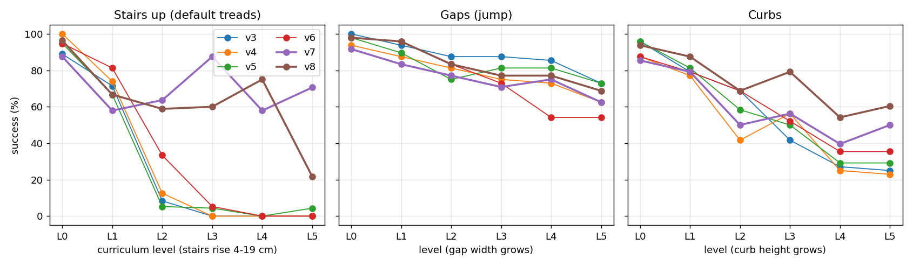

# PRIMUS: status and plan

*Updated 2026-11-11. History and reasoning behind each step: [experiments.md](experiments.md). Controller and
roadmap details: [control_roadmap.md](control_roadmap.md).*

## Where we are

| area | state |
|---|---|
| CAD, robot built, MuJoCo model, LQR + VMC controller, automatic landing gear | done, validated in simulation |
| Residual RL for rough ground and pushes (blind) | trained on the old controller; **needs retraining** after the 2026-11-06 controller changes |
| Perception stack (D435i map, RPLIDAR, planner, edge guard, A/B buttons) | done in simulation and on the CPU stack |
| Stand-up after a fall | trained (98.4% of episodes), on CPU front/back falls work; some side falls stick |
| Skill teacher (stairs, curbs, gaps, overhang) | **v8 = best realistic teacher**; stairs up at 19 cm only 22% |
| Hop to the next step / hurdles / wide gaps | **v9 training now** |
| Camera student | v1 (v3 teacher) and a GRU student (v5) exist; not rebuilt on v8 |
| Real robot | drivers, state estimation, actuator characterisation still open |

## Being done now: v9 (hop-assist exploration)

Goal: make the policy use the jump primitive near step edges so it lands flush on the next step, and extend the
skills to equestrian-style hurdles and wider gaps, keeping the realistic motor model unchanged.

- Run: `experiments/2026-11-11_17-34-16-skill-teacher-v9`, started from checkpoint 500 of the previous attempt
  (6500 iterations left, ~4.5 h). Log: `experiments/logs/v9_train.log`.
- Two crashes on the way (NaN policy at iteration 419 and ~660), both caused by off-policy injected samples; the
  causes and fixes are in [experiments.md §4](experiments.md). Run 3 is past both points.
- **Acceptance criteria** (agreed with the user): stairs up at 19 cm clearly above v8's 22%; gaps no worse than
  v8 (98/96/83/77/77/69%). v8 on the new terrains, level 0 → 5: hurdles 63→3%, gaps_wide 68→0%, stairs_long
  up 100→19%.
- **Checkpoint to watch:** around iteration ~1500 of the run, if falls on gaps and stairs stay high and
  `hop_climb` does not grow, stop and lower the injection probability or disable it on gaps.

## Next, in order

1. **Evaluate v9** with `skill_eval.py` against v8 per terrain and level; record the result in experiments.md
   (accepted, partially accepted, or the next hypothesis). Record videos (`record_skill_video.py`) on stairs
   19 cm, gaps and hurdles.
2. **If hops work:** relax the primitive (the policy modulates leg length during push/tuck instead of a fixed
   profile), then consider a from-scratch retrain with the final action space.
3. **Student distillation** from the winning teacher (camera-only / elevation map): short-history MLP (0.2 s) vs
   ~1 s MLP vs GRU, same configuration for the comparison. Known risk: the level camera cannot see inside a gap.
4. **Full-stack CPU tests**: rendered depth → map → planner → student → controller, plus guard, A/B and X (stand
   up).
5. **Retrain the blind residual** on the current controller (pending since 2026-11-06).
6. **Real robot:** actuator characterisation (replace the estimates in `hardware/actuators.json`), update mass,
   lidar 0° offset, odometry for the map, ONNX → TensorRT on the Jetson, moteus drivers and state estimation in
   `robot/`, reduced authority at first.
7. **Later:** banking in fast turns, front flip (needs measured actuators first).

## Decisions that shape the plan

| decision | reason |
|---|---|
| keep the realistic motor and hip model even though it costs performance | v7 numbers relied on motors the robot does not have |
| hop flush on the step instead of one wheel at a time | judged more stable; one-leg climbing is not possible without hip abduction |
| jump primitive stays, policy decides when/shape | pure learning never found the jump (v1, v8) |
| no new training without the owner's OK; every commit and push needs approval | project rule |
| docs in English, communication in Portuguese | project rule |

## Known limitations

- The jump clears 24–33 cm of wheel height with the realistic motors, with a small timing margin.
- Teacher results use a perfect height scan; student performance is lower, especially on gaps.
- Experiments, checkpoints and videos live outside this repository (`experiments/`, `videos/`); the repository
  keeps code, docs and the small figures in `docs/figures/`.
